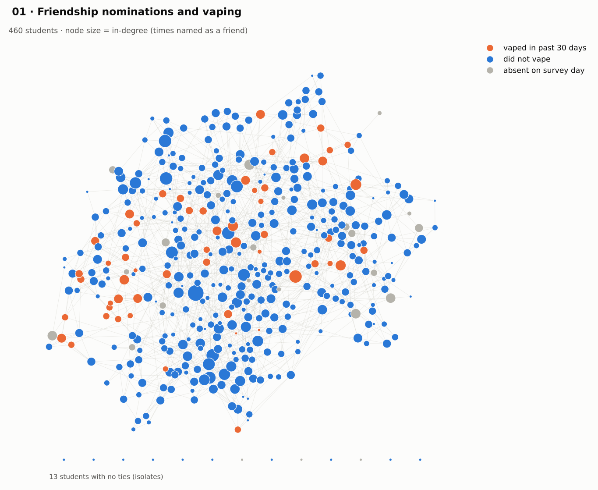
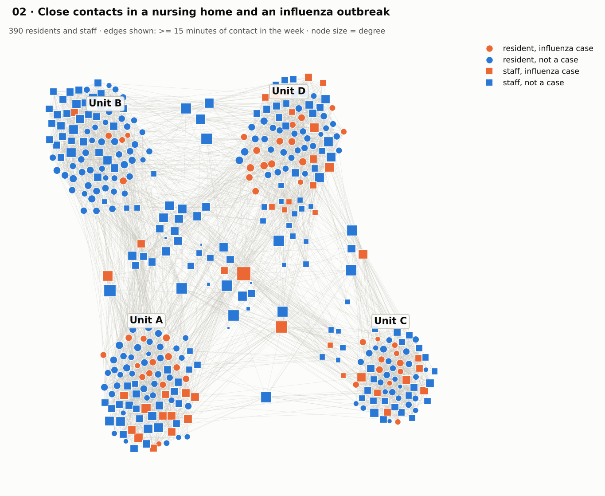
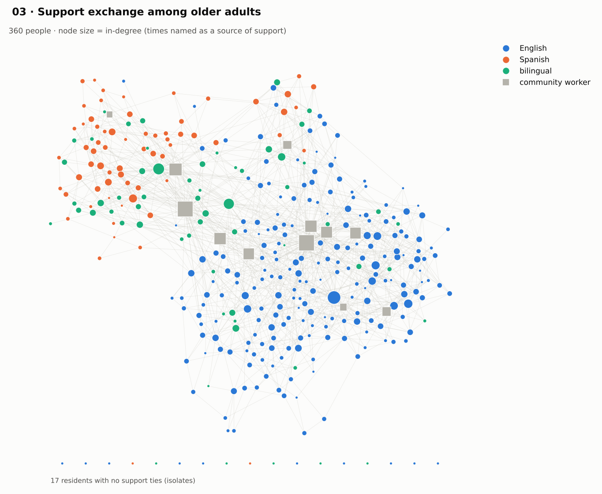
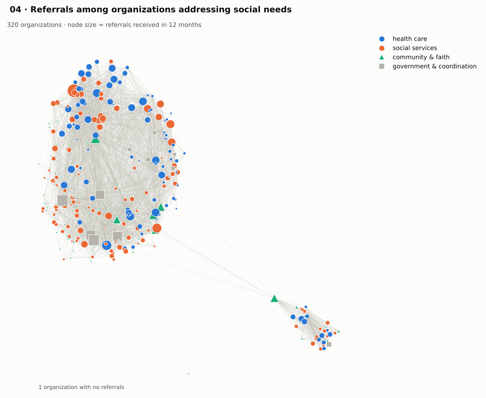
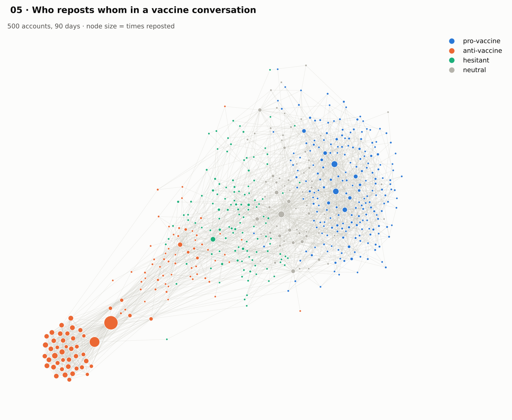
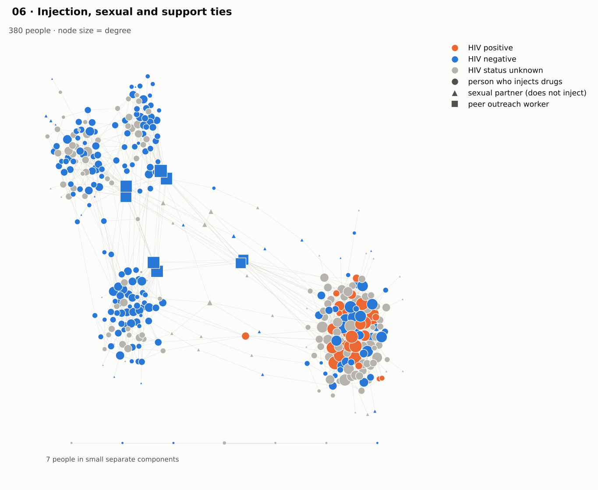
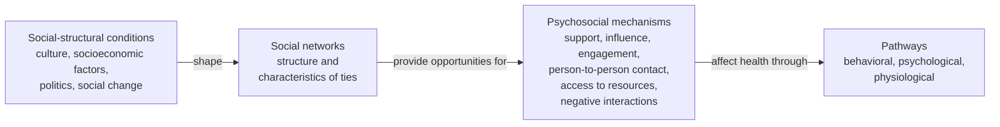

# Social Network Analysis in Public Health: Teaching Datasets

Six synthetic network datasets about public health problems, with a guide and ready-to-run code in Python and R. They were made for the social network analysis class of GHI/EPID 526 Digital Epidemiology (Mel and Enid Zuckerman College of Public Health, University of Arizona), for students who work with networks for the first time.

[](https://colab.research.google.com/github/onicio/epid526_SNA/blob/main/code/python/sna_walkthrough.ipynb)

> [!NOTE]
> All people and organizations in these datasets are simulated. Use them to learn the methods, not to make conclusions about the real world.

**Start here: [the guide](docs/SNA_Public_Health_Guide.md).** It has the conceptual model, the network measures in plain words, the documentation of each dataset, a step by step in Python, R and Gephi, and a quick wizard for GitHub.

<table>
  <tr>
    <td align="center"><a href="docs/SNA_Public_Health_Guide.md#51-friendship-nominations-and-youth-vaping"></a><br><sub><b>1.</b> Friendships and youth vaping</sub></td>
    <td align="center"><a href="docs/SNA_Public_Health_Guide.md#52-close-contacts-and-an-influenza-outbreak-in-a-nursing-home"></a><br><sub><b>2.</b> Influenza in a nursing home</sub></td>
    <td align="center"><a href="docs/SNA_Public_Health_Guide.md#53-social-support-and-loneliness-among-older-adults"></a><br><sub><b>3.</b> Support and loneliness in older adults</sub></td>
  </tr>
  <tr>
    <td align="center"><a href="docs/SNA_Public_Health_Guide.md#54-referrals-among-organizations-that-address-social-needs"></a><br><sub><b>4.</b> Referrals for social needs</sub></td>
    <td align="center"><a href="docs/SNA_Public_Health_Guide.md#55-a-vaccine-conversation-on-social-media"></a><br><sub><b>5.</b> A vaccine conversation online</sub></td>
    <td align="center"><a href="docs/SNA_Public_Health_Guide.md#56-people-who-inject-drugs-hiv-hepatitis-c-and-overdose"></a><br><sub><b>6.</b> HIV, hepatitis C and overdose</sub></td>
  </tr>
</table>

## The six datasets

| # | Dataset | Public health challenge | Nodes | Ties |
|---|---|---|---|---|
| 1 | [`01_school_vaping`](data/01_school_vaping) | youth vaping | 460 students | 1,675 friendship nominations (directed) |
| 2 | [`02_nursing_home_flu`](data/02_nursing_home_flu) | influenza outbreak in a nursing home | 390 residents and staff | 9,481 close contacts, weighted by minutes (undirected) |
| 3 | [`03_older_adults_support`](data/03_older_adults_support) | loneliness and social isolation | 360 older adults and community workers | 1,570 support ties, "A counts on B" (directed) |
| 4 | [`04_social_needs_referrals`](data/04_social_needs_referrals) | access to food, housing and care | 320 organizations | 3,442 referral ties, weighted by number of referrals (directed) |
| 5 | [`05_vaccine_conversation`](data/05_vaccine_conversation) | vaccine hesitancy and misinformation | 500 social media accounts | 2,564 repost ties, weighted by number of reposts (directed) |
| 6 | [`06_pwid_hiv_overdose`](data/06_pwid_hiv_overdose) | HIV, hepatitis C and overdose | 380 people | 1,332 ties in several layers: injection, sex, support, overdose response (undirected) |

## Which measure, where

Each network was built so that some measures tell a clear story. The guided questions of each dataset follow this table.

| Measure | 1 | 2 | 3 | 4 | 5 | 6 |
|---|:---:|:---:|:---:|:---:|:---:|:---:|
| Degree and strength | ✓ | ✓ | ✓ | ✓ | ✓ | ✓ |
| Betweenness | ✓ | ✓ | ✓ | ✓ | ✓ | ✓ |
| Closeness (harmonic) | ✓ | ✓ | ✓ | ✓ | ✓ | |
| Eigenvector | ✓ | ✓ | | ✓ | ✓ | ✓ |
| PageRank | ✓ | | ✓ | ✓ | ✓ | |
| Reciprocity | ✓ | | ✓ | ✓ | ✓ | |
| Clusters (communities, k-cores) | ✓ | ✓ | ✓ | ✓ | ✓ | ✓ |
| Homophily | ✓ | | ✓ | ✓ | ✓ | |
| Bridges, cut vertices and key players | ✓ | ✓ | ✓ | ✓ | | ✓ |
| Spread on the network (vaping, influenza, HIV) | ✓ | ✓ | | | | ✓ |

## How to use this repository

1. Read sections 2 and 3 of the guide: the conceptual model (how social networks affect health) and the measures in plain words.
2. Pick a dataset and read its documentation in section 5: the problem, the simulated study, the data dictionary and the guided questions.
3. Run the walkthrough of section 6 in Python or R. The same code works for the six datasets, you only change the dataset name.
4. Answer the guided questions. The code for each dataset is in `code/python/recipes.py` and `code/R/recipes.R`.
5. New to GitHub? Section 7 of the guide is a quick wizard to fork, clone, commit and push your work.

## Quick start

**Google Colab (nothing to install).** Click the "Open in Colab" button above. In Step 0 of the notebook, use the line that reads the data from GitHub:

```python
DATA_DIR = "https://raw.githubusercontent.com/onicio/epid526_SNA/main/data/" + DATASET
```

Colab and this address only work when the repository is public. If the repository is private, download it (green **Code** button > **Download ZIP**) and work on your computer.

**Python on your computer**

```bash
git clone https://github.com/onicio/epid526_SNA.git
cd epid526_SNA
pip install pandas networkx matplotlib scipy jupyter
cd code/python
python sna_walkthrough.py 01_school_vaping     # or open sna_walkthrough.ipynb in Jupyter
```

**R (RStudio)**

```r
install.packages(c("igraph", "tidygraph", "ggraph", "readr", "dplyr", "ggplot2"))
```

Open `code/R/sna_walkthrough.R`, set the working directory to `code/R` (`setwd("code/R")` from the project folder), choose the dataset in Step 0 and run the script. From a terminal: `Rscript sna_walkthrough.R 01_school_vaping`.

**Gephi (no code).** Open `data/<dataset>/network.graphml`. Section 6.3 of the guide shows the steps.

The walkthroughs save a figure and a table with all the measures in `outputs/`. This folder is not tracked by Git.

## Data format

Each dataset folder has three files:

| File | Content |
|---|---|
| `nodes.csv` | one row per node: `id` and the node attributes |
| `edges.csv` | one row per tie: `source`, `target`, `weight` and the tie attributes |
| `network.graphml` | the same network with all attributes, for Gephi or Cytoscape |

- A bigger `weight` always means a stronger tie (more minutes, more referrals, more types of support). For betweenness and closeness, use `distance = 1 / weight`.
- In the directed datasets the tie goes from `source` to `target`, for example "A named B as a friend" or "A reposted B".
- Empty cells are missing values, for example students who were absent on the survey day.
- Section 5 of the guide has the full data dictionary of each dataset.

## Repository structure

```text
epid526_SNA/
├── data/                              six datasets (nodes.csv, edges.csv, network.graphml)
├── code/
│   ├── python/                        walkthrough (script and notebook), recipes, interactive plot
│   └── R/                             walkthrough, recipes, interactive plot, ERGM example (statnet)
├── docs/
│   ├── SNA_Public_Health_Guide.md     the guide
│   └── figures/                       figures of the guide
├── LICENSE
└── README.md
```

## Conceptual model

The datasets follow the conceptual model of Berkman and Krishna (2014): social-structural conditions shape social networks, networks give opportunities for psychosocial mechanisms, and these mechanisms affect health through behavioral, psychological and physiological pathways. Section 2 of the guide shows where each dataset fits in the model.



## Software

- **Python** 3.10 or newer: pandas, networkx (3.4 or newer for the ForceAtlas2 layout), matplotlib and scipy. Optional: pyvis, for interactive plots.
- **R** 4.2 or newer: igraph (2.0 or newer), tidygraph, ggraph, readr, dplyr and ggplot2. Optional: visNetwork, and ergm, network and intergraph (statnet) for the ERGM example.
- **Gephi**, if you prefer to explore the networks without code.

## For instructors

- Section 8 of the guide has a suggested class plan.
- The answer key (planted structures and expected answers) and the code that generated the data are kept outside this repository.

## License and citation

The data, code and guide are dedicated to the public domain under [CC0 1.0](LICENSE): you can copy, change and use them without asking permission. If you use them in teaching or research, a citation is welcome:

> Leal Neto OB. *Social network analysis in public health: six synthetic teaching datasets.* GitHub repository; 2026. https://github.com/onicio/epid526_SNA

The conceptual model is from Berkman LF, Krishna A. Social network epidemiology. In: Berkman LF, Kawachi I, Glymour MM, editors. *Social Epidemiology*. 2nd ed. New York: Oxford University Press; 2014:234-289.
