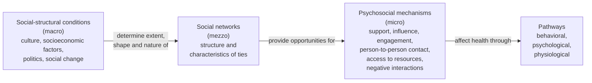
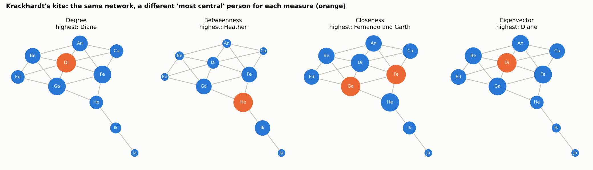
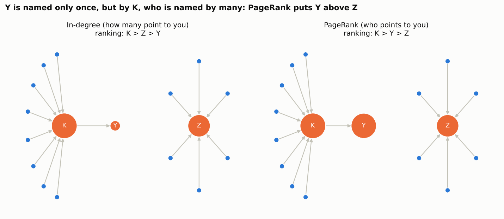

# Social Network Analysis in Public Health: Six Teaching Datasets

**Specifications, documentation and a step-by-step guide in Python and R**

> **About the data.** All people and organizations in these datasets are simulated. They were generated by code, from explicit rules, so that each network contains the situations we want students to discover (bridges, hubs, clusters, unreciprocated ties, isolates...). Any similarity with real persons or organizations is a coincidence. Do not use the numbers to make conclusions about the real world.

## Contents

1. [How to use this guide](#1-how-to-use-this-guide)
2. [Conceptual model: how social networks affect health](#2-conceptual-model-how-social-networks-affect-health)
3. [Network measures in plain words](#3-network-measures-in-plain-words)
4. [Files and data format](#4-files-and-data-format)
5. [The six datasets: specification and documentation](#5-the-six-datasets-specification-and-documentation)
   - [5.1 Friendship nominations and youth vaping](#51-friendship-nominations-and-youth-vaping)
   - [5.2 Close contacts and an influenza outbreak in a nursing home](#52-close-contacts-and-an-influenza-outbreak-in-a-nursing-home)
   - [5.3 Social support and loneliness among older adults](#53-social-support-and-loneliness-among-older-adults)
   - [5.4 Referrals among organizations that address social needs](#54-referrals-among-organizations-that-address-social-needs)
   - [5.5 A vaccine conversation on social media](#55-a-vaccine-conversation-on-social-media)
   - [5.6 People who inject drugs: HIV, hepatitis C and overdose](#56-people-who-inject-drugs-hiv-hepatitis-c-and-overdose)
6. [Step by step: build and analyze a network](#6-step-by-step-build-and-analyze-a-network)
   - [6.1 Python](#61-python-pandas--networkx--matplotlib)
   - [6.2 R](#62-r-igraph--tidygraph--ggraph-and-statnet)
   - [6.3 Gephi, without code](#63-gephi-without-code)
   - [6.4 Common errors and how to fix them](#64-common-errors-and-how-to-fix-them)
7. [GitHub quick wizard](#7-github-quick-wizard)
8. [Suggested class plan](#8-suggested-class-plan)
9. [References](#9-references)
10. [Appendix: how the data were generated](#appendix-how-the-data-were-generated)

---

## 1. How to use this guide

This guide goes with six network datasets about public health problems. Each dataset has between 320 and 500 nodes, attributes for the nodes and for the ties, and a short story. The datasets were prepared for a **first experience with social network analysis (SNA)**. The questions start simple (who has more ties?) and move to questions that need judgment (which measure should guide an intervention, and why?).

We follow one principle in all exercises: **the public health question comes first, the network measure is only the instrument.** So each dataset begins with a public health challenge, then shows which measures help to answer it, and also where a measure can mislead us.

**What you need**

- A computer with Python (3.10 or newer) or R (4.2 or newer), or only a web browser with [Google Colab](https://colab.research.google.com).
- Basic work with data tables (pandas in Python or dplyr in R). No previous experience with networks is needed.

**How the repository is organized**

```text
sna_public_health_datasets/
├── README.md                     short presentation and quick start
├── data/
│   ├── 01_school_vaping/         nodes.csv, edges.csv, network.graphml
│   ├── 02_nursing_home_flu/
│   ├── 03_older_adults_support/
│   ├── 04_social_needs_referrals/
│   ├── 05_vaccine_conversation/
│   └── 06_pwid_hiv_overdose/
├── code/
│   ├── python/   sna_walkthrough.py, sna_walkthrough.ipynb, recipes.py, interactive_plot.py
│   └── R/        sna_walkthrough.R, recipes.R, interactive_plot.R, ergm_example.R
└── docs/
    ├── SNA_Public_Health_Guide.md   (this file)
    └── figures/
```

**Suggested path for students**

1. Read sections 2 and 3 (the ideas).
2. Choose one dataset in section 5 and read its specification.
3. Run the walkthrough in section 6 (Python or R) with that dataset.
4. Answer the guided questions of the dataset. The "code recipe" under each dataset gives a start.
5. Save your work in GitHub (section 7).

**For instructors.** An answer key with the planted structures, the node IDs and the expected values is distributed separately. Keep it out of the student repository.

---

## 2. Conceptual model: how social networks affect health

The datasets were designed with the conceptual model of **Berkman and Krishna (2014)**, chapter 7 of *Social Epidemiology* (Figure 7.1, "Conceptual models of how social networks impact health"). The model is a cascade from upstream to downstream factors:

1. **Social-structural conditions (macro, upstream).** Culture (norms, social cohesion, racism), socioeconomic factors (inequality, discrimination, labor market, poverty), politics (laws, public policy, political participation) and social change (urbanization, war, economic recession). These conditions *determine the extent, shape and nature* of the social networks.
2. **Social networks (mezzo).** Two groups of characteristics:
   - *network structure*: size, transitivity, density, homogeneity, centrality, equivalence, distance;
   - *characteristics of the ties*: frequency of face-to-face and non-visual contact, participation in organizations, **reciprocity**, multiplexity, duration, intimacy.
3. **Psychosocial mechanisms (micro).** Networks *provide opportunities* for: social support (instrumental and financial, informational, appraisal, emotional), social influence (norms, peer pressure, social comparison), social engagement (meaningful roles, attachment), person-to-person contact (close contact, sexual contact), access to resources and material goods (jobs, health care, housing, institutional contact) and negative social interactions (demands, criticism, conflict, abuse).
4. **Pathways.** These mechanisms *affect health through* health behavioral pathways (smoking, alcohol and drugs, diet, exercise, adherence, help seeking), psychological pathways (self-efficacy, self-esteem, coping, depression, emotional regulation) and physiological pathways (HPA axis, allostatic load, immune function, inflammation, **transmission of infectious disease**).



*Diagram adapted from Berkman and Krishna (2014), Figure 7.1. If the diagram does not show, your viewer does not support Mermaid; GitHub shows it.*

Some ideas of the chapter are important for the exercises:

- **The same network can promote and damage health.** A network can give emotional support and also transmit an infection. Networks of people who use drugs can socialize risk, and some ties inside them (for example a partner who does not inject) can protect.
- **Not every tie is supportive.** Negative interactions (demands, criticism, conflict) happen most often with intimate ties.
- **Structure is upstream of support.** It is not enough to ask "do you have support?". We also need to see how the network is organized.
- **Egocentric and sociocentric designs.** Egocentric data describe the network around each person (for example the Lubben scale). Sociocentric data map the whole network of a bounded group (a school, a facility, a town). Our six datasets are sociocentric. Dataset 3 also has egocentric scores, so you can compare both.
- **Causality is hard.** When connected people are similar, it can be influence (contagion), selection (homophily: similar people become friends) or a shared environment. The chapter also reminds that many randomized trials of network or support interventions found null or modest effects. **In this guide every result is an association, not a proof of cause.**

### How each dataset maps to the model

| Dataset | Upstream conditions (examples) | Network (what is measured) | Main psychosocial mechanisms | Main pathway |
|---|---|---|---|---|
| 1. School friendships and vaping | youth culture and norms, marketing of flavored products, school socioeconomic context | friendship nominations (directed), reciprocity, homophily | social influence, social engagement | behavioral (vaping) |
| 2. Nursing home contacts and influenza | staffing policy, use of agency staff, financing of long-term care | minutes of close contact (weighted), units, staff who float | person-to-person contact | physiological (transmission) |
| 3. Older adults' support and loneliness | aging in place, widowhood, low income, language barriers, rural transport | support name generators (directed), reciprocity, multiplexity | social support, social engagement, negative interactions | psychological (loneliness, depressive symptoms) |
| 4. Referral network of organizations | funding, health and social policy, rurality | referrals between organizations (directed, weighted) | access to resources and material goods | access to care, food and housing |
| 5. Vaccine conversation online | political polarization, platform design, distrust | reposts (directed, weighted) | social influence (norms), information, misinformation | behavioral (vaccination, help seeking) |
| 6. People who inject drugs | drug policy, criminalization, poverty, rural health services | multiplex ties: injection, sex, support, overdose response | person-to-person contact, support, access to resources | physiological (HIV, HCV), overdose |

### From the chapter's network characteristics to the measures we compute

Berkman and Krishna list characteristics of nodes, ties and whole networks. The table shows how we measure them.

| Characteristic in the chapter | Measure in this guide | Python (networkx) | R (igraph) |
|---|---|---|---|
| Size, range | number of nodes, degree | `G.number_of_nodes()`, `G.degree()` | `vcount(g)`, `degree(g)` |
| Density | density | `nx.density(G)` | `edge_density(g)` |
| Reachability | components, paths | `nx.connected_components(U)`, `nx.has_path` | `components(g)`, `distances(g)` |
| Distance | shortest path length | `nx.shortest_path_length` | `distances(g)` |
| Centrality, popularity | degree, betweenness, closeness, eigenvector, PageRank | `nx.betweenness_centrality` ... | `betweenness(g)` ... |
| Reciprocity | reciprocity | `nx.reciprocity(G)` | `reciprocity(g)` |
| Transitivity | transitivity, clustering coefficient | `nx.transitivity(U)` | `transitivity(g)` |
| Bridging | betweenness, articulation points | `nx.articulation_points(U)` | `articulation_points(g)` |
| Clustering and segregation | communities, modularity | `nx.community.louvain_communities` | `cluster_louvain(g)` |
| Structural cohesion | k-cores | `nx.core_number(U)` | `coreness(g)` |
| Homogeneity | assortativity, E-I index | `nx.attribute_assortativity_coefficient` | `assortativity_nominal(g, ...)` |
| Multiplexity, frequency, duration, intimacy | edge attributes | edge columns in `edges.csv` | `E(g)$...` |
| Stability | change over time | not in these datasets (one time point) | |

---

## 3. Network measures in plain words

### Basic vocabulary

| Term | Meaning | Example in our datasets |
|---|---|---|
| **Node** (vertex, actor) | a unit in the network | a student, a nurse, an organization, an account |
| **Edge** (tie, link) | a relation between two nodes | "A named B as a friend", "A and B were in contact 40 minutes" |
| **Directed** network | the tie has a direction: A → B is not B → A | friendship nominations, referrals, reposts |
| **Undirected** network | the tie is mutual by definition | physical contact, injecting together |
| **Weight** | strength of the tie | minutes of contact, number of referrals |
| **Isolate** | node with no ties | a student nobody named and who named nobody |
| **Component** | group of nodes connected by some path | the large component plus small separate groups |
| **Path, distance** | sequence of ties between two nodes; distance = number of steps of the shortest path | friend of a friend = distance 2 |
| **Ego network** | one node (ego) and its direct contacts (alters) | the five friends of a student |
| **Multiplex tie** | more than one type of relation in the same pair | injected together *and* sexual partners |

### Centrality: important for what?

There is no single "most important" node. Each measure answers a different question. The figure shows the famous kite network of Krackhardt (1990): with the same ten people, three different persons are "the most central".



| Measure | Question it answers | Public health meaning | Best dataset to see it |
|---|---|---|---|
| **Degree** (in-degree, out-degree) | How many ties? | exposure (more contacts), popularity, activity | 1 (popular students), 2 (staff with many contacts) |
| **Strength** (weighted degree) | How much tie weight? | dose of exposure (minutes), volume of referrals | 2, 4 |
| **Betweenness** | How often is the node on the shortest paths between others? | bridges and brokers: they connect groups; good places for prevention, also routes for spread | 2 (float nurse), 3 (bilingual helper), 4 (211 helpline), 6 (person who moved) |
| **Closeness** / **harmonic closeness** | How near is the node to everybody? | how fast information or infection can reach the node, or leave it | 1 (new students), 2 (memory care unit), 4 (rural region) |
| **Eigenvector** | Is the node tied to well-connected nodes? | being inside the dense core of the network | 2 (therapy core), 5 (coordinated cluster), 6 (rural core) |
| **PageRank** | Is the node pointed to by nodes that are themselves pointed to (directed)? | influence or prestige that comes from *who* names you, not only *how many* | 1 (hidden influencer), 4 (referral destinations), 5 (researcher vs. bots) |
| **Reciprocity** | Does B also point to A? | mutual friendship, support exchange, two-way partnerships, coordination | 1, 3, 4, 5 |
| **Clustering / transitivity** | Are my friends also friends with each other? | closed groups, norms reinforced inside groups | 1, 3 |
| **Communities** (Louvain), **modularity** | Which groups are dense inside and sparse between them? | units, cliques, echo chambers, sectors | all |
| **k-core** | What is the largest group where everybody has at least k ties inside the group? | dense cores (for example a core of risk) | 6 |
| **Assortativity**, **E-I index** | Do similar nodes connect more (homophily)? | segregation of networks, echo chambers | 1, 3, 5 |
| **Articulation point** (cut vertex) | If this node disappears, does the network break? | single points of failure | 4, 6 |

**PageRank in one picture.** Y is named by only one node, but this node (K) is named by many. Z is named by six nodes that nobody names. In-degree puts Z above Y; PageRank puts Y above Z.



### Practical notes before you compute

1. **Weights can mean strength or distance.** In all six datasets a bigger `weight` means a *stronger* tie (more minutes, more referrals). Measures based on shortest paths (betweenness, closeness) treat weight as a *distance* (cost). So, for these measures, use `distance = 1 / weight`. In R, igraph uses an edge attribute named `weight` automatically, so always write `weights = NA` (no weights) or `weights = E(g)$distance`.
2. **Eigenvector centrality in directed networks.** It gives zero to many nodes (every node that nobody points to, and the nodes that only these nodes point to). In dataset 5 almost half of the accounts get zero. Use PageRank for directed networks, or compute eigenvector on the undirected version and say so.
3. **Closeness in disconnected networks.** When some nodes cannot reach others (isolates, small components), the classic closeness is not well defined, and Python and R handle it in different ways. **Harmonic closeness** (sum of 1/distance) works with disconnected networks and gives the same result in both languages.
4. **Normalization.** Packages scale measures differently (for example eigenvector with maximum 1 in igraph and with length 1 in networkx). Compare *rankings*, not raw values, between packages.
5. **Ties in rankings.** Many nodes have the same degree. When you select "the top 10", the order inside ties can change between packages, so small differences are normal.
6. **Include the isolates.** If you build the graph only from the edge list, people with no ties disappear. Always add the nodes from `nodes.csv` (see Step 2 of the walkthrough).

---

## 4. Files and data format

Every dataset folder has three files with the same network:

| File | Content | Use it with |
|---|---|---|
| `nodes.csv` | one row per node; first column `id`, then the node attributes | pandas, R, Excel |
| `edges.csv` | one row per tie; columns `source`, `target`, `weight`, then the tie attributes | pandas, R, Excel |
| `network.graphml` | the full network with all attributes in one file | Gephi, Cytoscape, networkx, igraph |

**Conventions used in all datasets**

- IDs are text with a prefix (`S` students, `R` residents, `H` health care workers, `P` persons, `CW` community workers, `ORG` organizations, `A` accounts). IDs were assigned at random, so the order of the rows has no meaning.
- In directed datasets an edge goes from `source` to `target`. The meaning of the direction is written in each specification ("A names B", "A refers to B", "A reposted B").
- `weight` is always positive and **bigger means a stronger tie**.
- Yes/no variables are coded `1` = yes and `0` = no.
- Missing values are empty cells. They are read as `NaN` in pandas and `NA` in R. Missing values are part of the realism: for example, students absent on the survey day.
- In undirected datasets each pair appears only once.

**Overview**

| # | Folder | Nodes | Edges | Direction | Weight means | Highlights |
|---|---|---|---|---|---|---|
| 1 | `01_school_vaping` | 460 students | 1,675 | directed (A names B as a friend) | closeness of the friendship (5 = best friend) | reciprocity, PageRank vs in-degree, bridges between grades, isolates |
| 2 | `02_nursing_home_flu` | 182 residents + 208 staff | 9,481 | undirected | minutes of close contact in one week | weighted betweenness, closeness by unit, eigenvector core, outbreak |
| 3 | `03_older_adults_support` | 348 residents + 12 community workers | 1,570 | directed (A counts on B for support) | number of support types (1 to 4) | reciprocity of support, isolates, brokers, loneliness |
| 4 | `04_social_needs_referrals` | 320 organizations | 3,442 | directed (A referred clients to B) | number of referrals in 12 months | PageRank, betweenness, cut vertex, one-way ties |
| 5 | `05_vaccine_conversation` | 500 accounts | 2,564 | directed (A reposted B) | number of reposts in 90 days | echo chambers, coordinated accounts, PageRank vs eigenvector |
| 6 | `06_pwid_hiv_overdose` | 320 PWID + 52 partners + 8 peer workers | 1,332 | undirected, multiplex | number of tie types (1 to 4) | k-core, layers, bridges, naloxone coverage |

---

## 5. The six datasets: specification and documentation

Each dataset has the same sections: the public health challenge, the link with the conceptual model, the (simulated) study design, the network specification, the data dictionary, what you will find, guided questions, a code recipe and points for discussion.

### 5.1 Friendship nominations and youth vaping

**Folder:** `data/01_school_vaping/`


**Public health challenge.** E-cigarettes are the tobacco product most used by adolescents in the United States. In the 2024 National Youth Tobacco Survey, 7.8% of high school students reported current (past 30 days) e-cigarette use (Jamal et al., 2024). Adolescents start these behaviors inside their friendship groups. Christakis and Fowler (2008) showed that smoking behavior clustered in the Framingham network up to three degrees of separation, and that whole groups quit together. Prevention programs such as ASSIST (Campbell et al., 2008) train students that their peers nominate as influential. The questions for the school are: *who should be peer leaders, and where is vaping concentrated?*

**Link to the conceptual model.** Upstream: youth culture and norms, marketing, school context. Network: directed friendship nominations, reciprocity, homophily. Mechanisms: social influence (norms, social comparison) and social engagement (teams, clubs). Pathway: health behavior (vaping).

**Study design (simulated).** A public high school in the US Southwest (fictional), grades 9 to 12. All students answered a confidential survey with student IDs, so the answers of different students can be linked (as in the Add Health study). Name generator: *"Name up to five of your closest friends in this school, starting with your best friend."* The survey also asked about vaping in the past 30 days, perceived vaping among friends, grades and depressive symptoms. School records provided grade, age, gender, race/ethnicity, free or reduced lunch, activities and transfer status. 23 students were absent on the survey day.

**Network specification**

| Item | Value |
|---|---|
| Node | student (460) |
| Edge | nomination: `source` named `target` as one of the 5 closest friends |
| Direction | directed |
| Weight | `weight = 6 - nomination_rank` (5 = best friend, 1 = fifth friend) |
| Edges | 1,675 nominations |
| Isolates | yes (students with no nominations sent or received) |
| Missing data | absent students have no out-nominations and missing survey items, but other students can name them |

**Data dictionary: nodes (`nodes.csv`)**

| Variable | Type | Values | Description |
|---|---|---|---|
| `id` | text | S001 to S460 | student ID |
| `grade` | integer | 9, 10, 11, 12 | school grade |
| `age` | integer | 14 to 18 | age in years |
| `gender` | text | female, male, nonbinary | self-reported gender |
| `race_ethnicity` | text | Hispanic/Latino, White, Black, Native American, Asian, Multiracial | from school records |
| `free_reduced_lunch` | 0/1 | | eligible for free or reduced-price lunch (proxy of family income) |
| `new_student` | 0/1 | | transferred to the school this year |
| `activity` | text | athletics, music, STEM club, arts/theater, none | main extracurricular activity |
| `team_club` | text | 15 values (football, soccer (girls), band, robotics, theater, none...) | specific team or club |
| `household_vaper_smoker` | 0/1 | missing if absent | someone at home smokes or vapes |
| `completed_survey` | 0/1 | | 0 = absent on survey day |
| `vaped_30d` | 0/1 | missing if absent | used an e-cigarette in the past 30 days |
| `vape_days_30d` | integer | 0 to 30 | days of use in the past 30 days |
| `perceived_friends_vaping` | integer | 0 to 5 | answer to "How many of your 5 closest friends vape?" |
| `gpa_band` | text | A, B, C, D/F | self-reported grades (some students skipped this item) |
| `phq2` | integer | 0 to 6 | PHQ-2 depressive symptoms score (3 or more = positive screen) |

**Data dictionary: edges (`edges.csv`)**

| Variable | Type | Values | Description |
|---|---|---|---|
| `source` | text | student ID | student who answered and named a friend |
| `target` | text | student ID | student who was named |
| `nomination_rank` | integer | 1 to 5 | position in the list (1 = best friend) |
| `weight` | integer | 1 to 5 | 6 minus `nomination_rank` |
| `days_together_week` | integer | 0 to 7 | days per week they spend time together outside class |
| `context` | text | classes, team/club, neighborhood, family/sibling, online/gaming, work | where they know each other from |
| `years_known` | number | 0.5 to 10 | years of friendship |
| `vaped_together` | 0/1 | | they have used e-cigarettes together |

**What you will find**

- **Reciprocity.** Only about one third of the nominations are returned. Younger athletes often name older teammates who do not name them back: unreciprocated ties point "up" in the status hierarchy.
- **Degree.** One senior athlete is named by many more students than anybody else. His friend group is the "popular crowd".
- **PageRank vs in-degree.** One student is named by only a few classmates, but these classmates are the most popular students, and they list this student first. In-degree ranks this student low; PageRank ranks the student near the top.
- **Betweenness.** A 10th grader with a modest number of nominations connects a group of seniors who vape with a group of 9th graders, and also welcomes a transfer student. This student is a bridge for diffusion (of vaping, or of a prevention message).
- **Closeness.** Transfer students sit at the periphery. Some students are isolates.
- **Clusters.** Small friend groups inside each grade. Louvain communities mostly follow grades, and one community concentrates vaping.
- **Homophily.** Strong by grade, moderate by gender and team, weak by race/ethnicity. Vaping students name other vaping students more than expected.
- **Distance.** The chance that a student vapes is higher when a friend vapes, smaller when a friend of a friend vapes, and close to the average after that.
- **Norms.** Students think that more of their friends vape than really do.

**Guided questions**

1. How many students, nominations and isolates are there? What is the density? Why is the density low even if most students named five friends?
2. What share of the nominations are reciprocated? Compare the reciprocity of nominations between students of the same grade and of different grades. *(reciprocity)*
3. Who are the five most nominated students? Now rank by PageRank. Find one student with low in-degree and high PageRank, and look at who nominates this student. *(degree, PageRank)*
4. Compute eigenvector centrality on the directed network and on the undirected version. How many students get zero in the directed version? Why? *(eigenvector)*
5. Which students have the highest betweenness? Look at the grades of their friends. Who connects the seniors who vape with younger students? *(betweenness)*
6. Compare the harmonic closeness of transfer students with the other students. *(closeness)*
7. Run Louvain. Do communities follow grades? What is the vaping prevalence in each community? *(clusters)*
8. Compute assortativity by grade, gender, race/ethnicity, team and vaping. Which attribute organizes the network most? *(homophily)*
9. Reproduce the "degrees of separation" analysis of Christakis and Fowler: the probability that a student vapes when a person at distance 1, 2, 3 or 4 vapes. Can you say that vaping *spreads* through friendships? What else could produce the same pattern?
10. The school can train 46 peer leaders (10%). Select them by in-degree, by PageRank and by betweenness. How many students are reached directly by each set? Why do the top-PageRank students reach fewer people? (Look at whether the leaders are friends of each other.)
11. Compare the perceived number of friends who vape with the real number among nominated friends. What does this mean for a social norms campaign?

**Code recipe**

<details>
<summary>Python</summary>

```python
nodes, edges, G = load("01_school_vaping", directed=True)
n = nodes.set_index("id")
surveyed = n[n.completed_survey == 1]
vape = surveyed.vaped_30d

# (a) Mutual vs one-way friendships: do friends share vaping status?
pairs = set(zip(edges.source, edges.target))
edges["mutual"] = [(t, s) in pairs for s, t in zip(edges.source, edges.target)]
e = edges[edges.source.isin(vape.index) & edges.target.isin(vape.index)].copy()
e["both_vape"] = [vape[s] == 1 and vape[t] == 1 for s, t in zip(e.source, e.target)]
e["source_vapes"] = [vape[s] == 1 for s in e.source]
print("P(friend vapes | I vape), mutual vs one-way ties:")
print(e[e.source_vapes].groupby("mutual").both_vape.mean().round(3))

# (b) Degrees of separation (Christakis & Fowler style)
U = G.to_undirected()
vapers = list(vape[vape == 1].index)
rows = []
for alter in vapers:
    dist = nx.single_source_shortest_path_length(U, alter, cutoff=4)
    for ego, d in dist.items():
        if d > 0 and ego in vape.index:
            rows.append((d, vape[ego]))
sep = pd.DataFrame(rows, columns=["distance", "ego_vapes"]).groupby("distance").ego_vapes.mean()
print("\nP(ego vapes | a person at distance d vapes):")
print(sep.round(3))
print("baseline prevalence:", round(vape.mean(), 3))

# (c) Choosing 46 peer leaders (10%): who reaches more students in one step?
k = 46
scores = {
    "in-degree": dict(G.in_degree()),
    "PageRank": nx.pagerank(G),
    "betweenness": nx.betweenness_centrality(G),
    "random": dict(zip(G.nodes(), np.random.default_rng(1).random(G.number_of_nodes()))),
}
for name, sc in scores.items():
    leaders = set(sorted(sc, key=sc.get, reverse=True)[:k])
    reached = set(leaders)
    for x in leaders:
        reached |= set(U.neighbors(x))
    print(f"{name:12s} leaders reach {len(reached) / G.number_of_nodes():.0%} of students")

# (d) Perceived norm vs reality
actual = [sum(vape.get(j, 0) == 1 for j in G.successors(i)) for i in surveyed.index]
print("\nMean perceived number of vaping friends:", round(surveyed.perceived_friends_vaping.mean(), 2))
print("Mean actual number among nominated friends:", round(np.mean(actual), 2))
```
</details>

<details>
<summary>R</summary>

```r
net <- load_net("01_school_vaping", directed = TRUE)
g <- net$g; nodes <- net$nodes; edges <- net$edges
vape <- setNames(nodes$vaped_30d, nodes$id)            # NA = absent on survey day

# (a) Mutual vs one-way friendships: do friends share vaping status?
edges$mutual <- paste(edges$target, edges$source) %in% paste(edges$source, edges$target)
e <- edges |> filter(!is.na(vape[source]), !is.na(vape[target]), vape[source] == 1)
e |> group_by(mutual) |> summarise(p_friend_vapes = mean(vape[target] == 1)) |> print()

# (b) Degrees of separation
u <- as_undirected(g, mode = "collapse")
vapers <- names(vape)[which(vape == 1)]
d <- distances(u, v = vapers, to = V(u), weights = NA)      # rows = vapers, columns = everyone
ego_vape <- vape[colnames(d)]
sep <- sapply(1:4, function(k) mean(ego_vape[col(d)[d == k]], na.rm = TRUE))
print(data.frame(distance = 1:4, p_ego_vapes = round(sep, 3)))
cat("baseline prevalence:", round(mean(vape, na.rm = TRUE), 3), "\n")

# (c) Choosing 46 peer leaders (10%)
k <- 46
set.seed(1)
scores <- list(`in-degree` = degree(g, mode = "in"),
               PageRank = page_rank(g)$vector,
               betweenness = betweenness(g, weights = NA),
               random = setNames(runif(vcount(g)), V(g)$name))
for (s in names(scores)) {
  leaders <- names(sort(scores[[s]], decreasing = TRUE))[1:k]
  reached <- unique(c(leaders, unlist(lapply(adjacent_vertices(u, leaders), names))))
  cat(sprintf("%-12s leaders reach %.0f%% of students\n", s, 100 * length(reached) / vcount(g)))
}

# (d) Perceived norm vs reality
surveyed <- nodes |> filter(completed_survey == 1)
actual <- sapply(surveyed$id, function(i) {
  f <- names(neighbors(g, i, mode = "out")); sum(vape[f] == 1, na.rm = TRUE) })
cat("perceived:", round(mean(surveyed$perceived_friends_vaping), 2),
    "| actual among nominated friends:", round(mean(actual), 2), "\n")
```
</details>

**Discussion and limitations**

- Friendship nominations are limited to five and to the same school. Friends outside school (the network boundary) are not seen.
- Absent students did not nominate anyone, so their reciprocity is underestimated. How would you handle this?
- Clustering of vaping is consistent with influence, but also with selection (students who vape choose each other) and with a shared environment (same neighborhood, same household exposure).
- Real school network data about minors need special consent, assent and protection.

### 5.2 Close contacts and an influenza outbreak in a nursing home

**Folder:** `data/02_nursing_home_flu/`


**Public health challenge.** Influenza outbreaks in nursing homes are frequent and severe. Residents are old, frail and many have dementia. Vaccines protect older adults less well than younger adults, so the vaccination of staff and the way staff move between units matter. Studies with wearable proximity sensors measured who is in face-to-face contact with whom in hospital wards (Vanhems et al., 2013) and combined these contacts with virological data to find likely transmission routes of influenza (Voirin et al., 2015). The questions for the infection preventionist are: *who connects the units, which residents are most exposed, and would "cohorting" staff by unit reduce the spread?*

**Link to the conceptual model.** Upstream: staffing policy, use of agency staff, financing of long-term care. Network: duration and frequency of close contact, units, staff who float. Mechanism: person-to-person contact. Pathway: physiological (transmission of an infectious disease).

**Study design (simulated).** A 182-bed skilled nursing facility (fictional) with four units: A and B (long-term care), C (locked memory care unit) and D (short-stay rehabilitation after hospital discharge). During one week, residents and staff wore small sensors that record close-range (about 1.5 meters) face-to-face contacts in 20-second windows (SocioPatterns-like design). Contacts were summed for each pair over the week; pairs with less than one minute in total were removed. In the weeks after the sensor week, an influenza A outbreak happened; the infection prevention team kept a line list (cases, onset day, test result). The outbreak was declared after three resident cases in one week; then the team isolated symptomatic residents, gave antiviral prophylaxis to residents and asked staff to wear masks.

**Network specification**

| Item | Value |
|---|---|
| Node | resident (182) or staff member (208) |
| Edge | the two people were in close face-to-face contact for at least 1 minute during the sensor week |
| Direction | undirected |
| Weight | total minutes of contact in the week |
| Edges | 9,481 pairs |
| Isolates | none |
| Note | a dense network: try also the network of "close contacts" with 15 minutes or more |

**Data dictionary: nodes**

| Variable | Type | Values | Description |
|---|---|---|---|
| `id` | text | R001 to R182 (residents), H001 to H208 (staff) | person ID |
| `person_type` | text | resident, staff | |
| `role` | text | resident, CNA, LPN, RN, RN supervisor, director of nursing, infection preventionist, physician, nurse practitioner, physical/occupational/speech therapist, activities, housekeeping, dietary, social worker, administration, maintenance | job of staff members |
| `unit` | text | residents: A, B, C, D. Staff: home unit or area (A to D, float pool, facility-wide, therapy, kitchen, office, A+B...) | |
| `shift` | text | day, evening, night | staff only |
| `employment` | text | facility, agency | staff only; agency staff are temporary and may work in many places |
| `units_worked` | text | for example A, C+D, A+B+C+D | units where the person worked or lived during the sensor week |
| `shifts_worked` | integer | 2 to 5 | shifts in the sensor week (staff only) |
| `age` | integer | | years |
| `sex` | text | female, male | |
| `room` | text | for example A105 | resident room; most rooms have two residents (roommates) |
| `adl_score` | integer | 0 to 28 | dependency in activities of daily living (MDS scale, higher = needs more help); residents only |
| `mobility` | text | independent, walker/cane, wheelchair, bedbound | residents only |
| `dementia` | 0/1 | | residents only |
| `length_of_stay_days` | integer | | days since admission (short in unit D) |
| `flu_vaccinated` | 0/1 | | received this season's influenza vaccine |
| `flu_case` | 0/1 | | influenza-like illness during the outbreak (line list) |
| `onset_day` | integer | 1 to 32 | day of symptom onset (day 1 = first case); empty if not a case |
| `flu_test` | text | positive, negative, not tested | PCR result; a few cases tested negative (late sample), and some people with respiratory symptoms tested negative and are not cases |

**Data dictionary: edges**

| Variable | Type | Values | Description |
|---|---|---|---|
| `source`, `target` | text | person IDs | the two people (order has no meaning) |
| `weight` | number | 1 to about 820 | total minutes of close contact in the week |
| `n_contacts` | integer | | number of separate contact events |
| `days_in_contact` | integer | 1 to 7 | days with at least one contact |
| `contact_type` | text | resident-resident, staff-resident, staff-staff | |
| `main_location` | text | resident room, dining room, lounge, activity room, therapy gym, nursing station, break room, hallway, office | where most of the contact happened |

**What you will find**

- **Clusters.** The four units are four clear communities (the therapists join unit D, where the rehabilitation residents are). The other communities are not units: housekeeping and maintenance, the kitchen, and the office (administration, nursing supervisors, infection prevention).
- **Degree and strength.** Nurses (LPN, RN, nurse practitioners) have the most contacts, and one nurse who works in all four units has the most of all. Therapists and activities staff have fewer contacts but the most minutes. Residents who need more help get more minutes of contact with staff.
- **Betweenness (weighted).** A few staff members who work in several units connect the units. Look at their employment type and vaccination status.
- **Closeness.** Residents of the locked memory care unit are the most peripheral.
- **Eigenvector (weighted).** The top of the ranking is dominated by therapists, because they spend long sessions with rehabilitation residents and with each other. Eigenvector centrality "falls into" the most intense dense group. This is a real property of the measure, not an error.
- **PageRank.** In an undirected network, PageRank follows strength closely. It adds little here.
- **Outbreak.** The first case is a resident admitted to the rehabilitation unit. The epidemic curve shows when the other units were reached.

**Guided questions**

1. Compute density and mean degree. Why is this network much denser than the friendship network of dataset 1?
2. Keep only contacts of 15 minutes or more. What changes in density and in the ranking of central nodes? Discuss how the threshold choice affects conclusions.
3. Compare degree and strength by role. Which roles have many short contacts, and which have few long contacts? Is `adl_score` associated with the minutes of contact with staff? *(degree, strength)*
4. Compute betweenness with `distance = 1 / minutes`. Who are the top five? What do they have in common? *(betweenness)*
5. Compare the mean closeness of residents in each unit. Which unit is most peripheral? Is that good or bad during an outbreak? *(closeness)*
6. Run Louvain. Do the communities match the units? Which communities are not units? *(clusters)*
7. Rank by weighted eigenvector centrality. Who is on top and why? Compare with unweighted eigenvector. *(eigenvector)*
8. Compute the attack rate by unit, by vaccination and by quartile of degree. Make the epidemic curve by unit. When did the virus reach each unit?
9. Look at the staff with high betweenness: were they cases? When was their onset compared with the first cases in units A, B and C?
10. Simulate staff cohorting: remove the nursing staff who float between units and count how many residents in *other* units are only one staff member away. What does this suggest for infection control?

**Code recipe**

<details>
<summary>Python</summary>

```python
nodes, edges, G = load("02_nursing_home_flu", directed=False)
n = nodes.set_index("id")
for a, b, d in G.edges(data=True):
    d["distance"] = 1 / d["weight"]          # more minutes = "closer"

# (a) Keep only "close contacts": 15 minutes or more in the week
H = nx.Graph()
H.add_nodes_from(G.nodes(data=True))
H.add_edges_from((a, b, d) for a, b, d in G.edges(data=True) if d["weight"] >= 15)
print("edges all / >=15 min:", G.number_of_edges(), "/", H.number_of_edges())

# (b) Who connects the units? weighted betweenness
btw = pd.Series(nx.betweenness_centrality(G, weight="distance"))
top = btw.sort_values(ascending=False).head(8).index
print(n.loc[top, ["role", "unit", "units_worked", "employment", "flu_vaccinated"]].assign(btw=btw[top].round(3)))

# (c) Attack rates
res = n[n.person_type == "resident"]
print("\nResident attack rate by unit:")
print(res.groupby("unit").flu_case.agg(["mean", "sum", "count"]).round(2))
print("Attack rate by vaccination (everyone):")
print(n.groupby("flu_vaccinated").flu_case.mean().round(3))
n["degree"] = pd.Series(dict(G.degree()))
n["degree_quartile"] = pd.qcut(n.degree, 4, labels=["Q1 (fewest)", "Q2", "Q3", "Q4 (most)"])
print("Attack rate by degree quartile:")
print(n.groupby("degree_quartile", observed=True).flu_case.mean().round(3))

# (d) Epidemic curve: residents by unit, staff together
cases = n[n.flu_case == 1].copy()
cases["group"] = np.where(cases.person_type == "resident", "unit " + cases.unit, "staff")
print("\nCases by week of onset:")
print(pd.crosstab(cases.group, (cases.onset_day.astype(int) - 1) // 7 + 1).rename(columns=lambda w: f"week {w}"))

# (e) Staff cohorting: what if nursing staff did not float between units?
def residents_one_staff_away(graph):
    """Mean number of residents in OTHER units reachable through one staff member."""
    counts = []
    for r_id in res.index:
        others = set()
        for s_id in graph.neighbors(r_id):
            if n.loc[s_id, "person_type"] == "staff":
                others |= {x for x in graph.neighbors(s_id)
                           if x in res.index and n.loc[x, "unit"] != n.loc[r_id, "unit"]}
        counts.append(len(others))
    return np.mean(counts)
floaters = [i for i in n.index if n.loc[i, "role"] in ("CNA", "LPN", "RN") and "+" in str(n.loc[i, "units_worked"])]
Hc = H.copy()
Hc.remove_nodes_from(floaters)
print(f"\nFloating nursing staff: {len(floaters)} people")
print("Residents in other units only one staff member away (>=15 min contacts):",
      round(residents_one_staff_away(H), 1), "->", round(residents_one_staff_away(Hc), 1), "without floating staff")
```
</details>

<details>
<summary>R</summary>

```r
net <- load_net("02_nursing_home_flu", directed = FALSE)
g <- net$g; nodes <- net$nodes
E(g)$distance <- 1 / E(g)$weight

# (a) Close contacts only (>= 15 minutes in the week)
h <- delete_edges(g, E(g)[weight < 15])
cat("edges all / >=15 min:", ecount(g), "/", ecount(h), "\n")

# (b) Weighted betweenness (distance = 1 / minutes)
btw <- betweenness(g, weights = E(g)$distance, normalized = TRUE)
top <- names(sort(btw, decreasing = TRUE))[1:8]
nodes |> filter(id %in% top) |>
  select(id, role, unit, units_worked, employment, flu_vaccinated) |>
  mutate(btw = round(btw[id], 3)) |> arrange(desc(btw)) |> print()

# (c) Attack rates
nodes |> filter(person_type == "resident") |> group_by(unit) |>
  summarise(attack_rate = mean(flu_case), cases = sum(flu_case), n = n()) |> print()
nodes |> group_by(flu_vaccinated) |> summarise(attack_rate = mean(flu_case)) |> print()
nodes$degree <- degree(g)[nodes$id]
nodes |> mutate(q = ntile(degree, 4)) |> group_by(q) |>
  summarise(attack_rate = round(mean(flu_case), 3)) |> print()

# (d) Epidemic curve by week of onset
cases <- nodes |> filter(flu_case == 1) |>
  mutate(group = ifelse(person_type == "resident", paste("unit", unit), "staff"),
         week = (onset_day - 1) %/% 7 + 1)
print(table(cases$group, cases$week))

# (e) Staff cohorting: residents in other units reachable through one staff member
res_ids <- nodes$id[nodes$person_type == "resident"]
unit_of <- setNames(nodes$unit, nodes$id)
type_of <- setNames(nodes$person_type, nodes$id)
one_staff_away <- function(graph) {
  mean(sapply(res_ids, function(r) {
    staff <- names(neighbors(graph, r)); staff <- staff[type_of[staff] == "staff"]
    if (length(staff) == 0) return(0)
    two <- unique(unlist(lapply(staff, function(s) names(neighbors(graph, s)))))
    sum(two %in% res_ids & unit_of[two] != unit_of[r])
  }))
}
floaters <- nodes$id[nodes$role %in% c("CNA", "LPN", "RN") & grepl("\\+", nodes$units_worked)]
cat("floating nursing staff:", length(floaters), "\n")
cat("residents in other units one staff member away:", round(one_staff_away(h), 1), "->",
    round(one_staff_away(delete_vertices(h, floaters)), 1), "without floating staff\n")
```
</details>

**Discussion and limitations**

- Sensors measure proximity, not transmission. A contact network shows possible routes.
- Contacts were measured in one week and the outbreak happened in the next weeks. Contacts change, especially after control measures.
- Asymptomatic infections are not in the line list, so some links of the chain are invisible.
- Wearing sensors at work raises questions about privacy and workplace surveillance; real studies need clear consent and data protection.

### 5.3 Social support and loneliness among older adults

**Folder:** `data/03_older_adults_support/`


**Public health challenge.** Social isolation and loneliness are common in later life and are linked to mortality, depression, cognitive decline and use of health services. The Alameda County study showed that people with fewer social ties had higher mortality (Berkman and Syme, 1979), and later meta-analyses confirmed the association. Support is an exchange: people give and receive, and norms of reciprocity are important, but older adults with disabilities often cannot give back (Berkman and Krishna, 2014). The questions for a healthy aging program are: *who is isolated, who carries the support load of the community, and who connects groups that do not speak the same language?*

**Link to the conceptual model.** Upstream: aging in place, widowhood, low income, language barriers, rural transport. Network: four name generators of support, reciprocity, multiplexity, frequency and duration of ties. Mechanisms: social support (emotional, instrumental, informational, appraisal), social engagement (senior center, church, volunteering) and negative interactions (strain). Pathway: psychological (loneliness, depressive symptoms) and cognitive function.

**Study design (simulated).** A small town in the US Southwest (fictional) with five areas: a retirement park, an old town, a Spanish-speaking barrio, a dispersed rural edge and a building of senior apartments. All 348 residents aged 60 or more were interviewed in English or Spanish. Four name generators were used, with no fixed limit on the number of names (most residents named between 2 and 8 people; a few very active residents named more than 15):

- Emotional: *"Who do you talk with about personal matters or things that worry you?"*
- Instrumental: *"Who would help you with rides, groceries or chores if you needed?"*
- Informational: *"Who gives you advice or information about health and services?"*
- Appraisal: *"Who helps you think through important decisions?"*

Respondents could name other residents or community workers (a community health worker, the senior center coordinator, a deacon, a pastor, a pharmacist, a home health nurse and others). The 12 community workers were also interviewed about their own sources of support. The survey included the Lubben Social Network Scale (LSNS-6), the 3-item loneliness scale, the CES-D 10 and a cognitive screening test. For each named person, respondents said how often they meet, how long they know each other and how often this person makes demands or criticizes them (MIDUS-style strain items).

**Network specification**

| Item | Value |
|---|---|
| Node | resident aged 60+ (348) or community worker (12) |
| Edge | `source` counts on `target` for at least one type of support |
| Direction | directed. In-degree = how many people count on you |
| Weight | number of support types in the tie (1 to 4) = multiplexity |
| Edges | 1,570 |
| Isolates | yes |
| Missing data | community workers have no personal attributes; some residents did not complete the cognitive test |

**Data dictionary: nodes**

| Variable | Type | Values | Description |
|---|---|---|---|
| `id` | text | P001 to P348, CW01 to CW12 | person ID |
| `node_type` | text | resident, community worker | |
| `role` | text | resident or the community worker's job | |
| `neighborhood` | text | N1 Retirement park, N2 Old town, N3 Barrio San Isidro, N4 Rural edge, N5 Senior apartments, outside | area of residence (community workers: area of work) |
| `age` | integer | 60 to 93 | years |
| `gender` | text | woman, man | |
| `language` | text | English, Spanish, bilingual | language used in daily life |
| `marital_status` | text | married/partnered, widowed, divorced/separated, never married | |
| `household` | text | alone, with spouse/partner, with family, with spouse and family | |
| `lives_alone` | 0/1 | | |
| `years_in_community` | integer | | years living in this town |
| `religious_attendance` | text | weekly, monthly, rarely, never | |
| `congregation` | text | St. Isidore parish, Community church, other, none | |
| `senior_center_member` | 0/1 | | |
| `volunteers` | 0/1 | | does volunteer work |
| `drives` | 0/1 | | still drives |
| `mobility_limitation` | text | none, some, severe | |
| `hearing_loss` | 0/1 | | |
| `chronic_conditions` | integer | 0 to 7 | number of chronic conditions |
| `sni_score` | integer | 0 to 4 | simplified Social Network Index (Berkman and Syme): married + 3 or more close contacts + religious attendance at least monthly + group member |
| `lsns6` | integer | 0 to 30 | Lubben Social Network Scale-6 (ego-reported, includes family who live elsewhere); less than 12 = risk of isolation |
| `ucla3_loneliness` | integer | 3 to 9 | 3-item loneliness scale (Hughes et al., 2004); 6 or more = lonely |
| `cesd10` | integer | 0 to 30 | depressive symptoms (CES-D 10); 10 or more = elevated |
| `cognitive_score` | integer | 0 to 30 | cognitive screening score (higher = better); some missing |
| `fall_past_year` | 0/1 | | had a fall in the past 12 months |

**Data dictionary: edges**

| Variable | Type | Values | Description |
|---|---|---|---|
| `source` | text | person ID | the person who counts on `target` |
| `target` | text | person ID | the person who gives support |
| `relationship` | text | spouse/partner, family, friend, neighbor, church member, senior center friend, professional, colleague | |
| `emotional`, `instrumental`, `informational`, `appraisal` | 0/1 | | types of support given by `target` to `source` |
| `weight` | integer | 1 to 4 | sum of the four types (multiplexity) |
| `face_to_face_per_month` | integer | | meetings per month |
| `phone_video_per_month` | integer | | calls or video calls per month |
| `years_known` | integer | | |
| `strain` | integer | 0 to 3 | how often this person makes too many demands or criticizes (0 = never, 3 = often) |

**What you will find**

- **Reciprocity.** About half of the support ties are returned. Spouses always, family very often, neighbors much less. Ties to community workers are almost never returned (they are professionals). Residents with severe mobility limitations count on others, but the people they name count on them much less often (about one tie in three is returned, against more than half for the other residents).
- **Isolates.** A group of residents with no support ties at all, concentrated in one area. Look at living alone, hearing loss and driving.
- **Degree.** One retired resident is named by many neighbors: a "super-helper" who may be overloaded.
- **PageRank vs in-degree.** The top PageRank node is not the most named person. It is a professional named by the other community workers: the helpers' helper.
- **Betweenness.** A bilingual resident and the community health worker connect the Spanish-speaking area with the rest of the town.
- **Closeness.** Two areas are peripheral.
- **Clusters and homophily.** Communities follow neighborhoods, language and congregation.
- **Loneliness.** Fewer ties go with more loneliness, but the association is moderate: some people are lonely with many ties (ties with strain), and some people with almost no local ties are not lonely (close family living elsewhere).
- **Egocentric vs sociocentric.** LSNS-6 and the number of ties in the network are correlated but not the same, because LSNS-6 also counts family who live outside the town.

**Guided questions**

1. What is the overall reciprocity? Compute reciprocity by type of relationship. Which ties are rarely returned and why? *(reciprocity)*
2. For each resident, compute the share of the people they count on who also count on them. Compare by mobility limitation. Relate to the idea of norms of reciprocity in late life.
3. How many residents are isolates? Where do they live and what are their characteristics? Compare with LSNS-6 below 12.
4. Correlate LSNS-6 with the number of ties in the network. Why are they different? (Think about the boundary of the network.)
5. Who has the highest in-degree? What could be the risks for this person? *(degree)*
6. Compare in-degree and PageRank, especially among community workers. Who is the helpers' helper? Why does that matter if this person leaves the job? *(PageRank)*
7. Who has the highest betweenness? Remove the top three brokers: what happens to the distance between Spanish-speaking and English-speaking residents? *(betweenness)*
8. Compare harmonic closeness by neighborhood. *(closeness)*
9. Run Louvain and compare with neighborhood, language and congregation. Compute assortativity for each. *(clusters, homophily)*
10. Plot loneliness against the number of ties. Find people who are lonely despite many ties and look at the strain of their ties. Find people with few ties who are not lonely.
11. Which relationships carry more types of support (multiplexity)? Which carry more strain?

**Code recipe**

<details>
<summary>Python</summary>

```python
nodes, edges, G = load("03_older_adults_support", directed=True)
n = nodes.set_index("id")
res = n[n.node_type == "resident"].copy()

# (a) Reciprocity by relationship and by mobility
pairs = set(zip(edges.source, edges.target))
edges["reciprocated"] = [(t, s) in pairs for s, t in zip(edges.source, edges.target)]
print(edges.groupby("relationship").reciprocated.mean().round(2).sort_values())
# node level: share of the people I count on who also count on me
res["reciprocity"] = edges.groupby("source").reciprocated.mean()
print(res.groupby("mobility_limitation").reciprocity.mean().round(2))

# (b) Isolates: who are they?
res["in_deg"] = pd.Series(dict(G.in_degree()))
res["out_deg"] = pd.Series(dict(G.out_degree()))
res["total_deg"] = res.in_deg + res.out_deg
iso = res[res.total_deg == 0]
print("\nIsolates:", len(iso))
print(iso.neighborhood.value_counts())
print("share living alone:", round(iso.lives_alone.mean(), 2), "| hearing loss:", round(iso.hearing_loss.mean(), 2))

# (c) Ego-reported network (LSNS-6) vs sociocentric ties
print("\nSpearman(LSNS-6, sociocentric degree):", round(res.lsns6.corr(res.total_deg, method="spearman"), 2))
print(res.groupby(res.lsns6 < 12).total_deg.describe().round(1))

# (d) Loneliness and number of ties
res["ties_group"] = pd.cut(res.total_deg, [-1, 0, 2, 5, 100], labels=["0", "1-2", "3-5", "6+"])
print(res.groupby("ties_group", observed=True).ucla3_loneliness.agg(["mean", "count"]).round(2))
strain = edges.groupby("source").strain.sum()
res["strain_total"] = strain.reindex(res.index).fillna(0)
lonely_crowd = res[(res.ucla3_loneliness >= 6) & (res.total_deg >= 5)]
print("lonely with 5+ ties:", len(lonely_crowd), "| mean strain:", round(lonely_crowd.strain_total.mean(), 2),
      "vs others:", round(res.strain_total.mean(), 2))

# (e) Brokers, and what happens if the main community worker leaves
btw = pd.Series(nx.betweenness_centrality(G)).sort_values(ascending=False)
print(n.loc[btw.index[:6], ["role", "neighborhood", "language"]].assign(btw=btw[:6].round(3)))
U = G.to_undirected()
spanish = [i for i in res.index if res.loc[i, "language"] == "Spanish"]
english = set(res.index[res.language == "English"])
def steps_to_english(graph):
    d = []
    for s in spanish:
        if s in graph:
            dist = nx.single_source_shortest_path_length(graph, s)
            reach = [dist[e] for e in english if e in dist]
            if reach:
                d.append(np.mean(reach))
    return round(np.mean(d), 2)
U2 = U.copy()
U2.remove_nodes_from(btw.index[:3])     # the three main brokers leave
print("Mean steps from Spanish-speaking to English-speaking residents:",
      steps_to_english(U), "->", steps_to_english(U2), "without the top-3 brokers")
```
</details>

<details>
<summary>R</summary>

```r
net <- load_net("03_older_adults_support", directed = TRUE)
g <- net$g; nodes <- net$nodes; edges <- net$edges

# (a) Reciprocity by relationship and by mobility limitation
edges$reciprocated <- paste(edges$target, edges$source) %in% paste(edges$source, edges$target)
edges |> group_by(relationship) |> summarise(reciprocated = round(mean(reciprocated), 2)) |>
  arrange(reciprocated) |> print()
node_rec <- edges |> group_by(source) |> summarise(reciprocity = mean(reciprocated))
res <- nodes |> filter(node_type == "resident") |> left_join(node_rec, by = c("id" = "source"))
res |> group_by(mobility_limitation) |> summarise(reciprocity = round(mean(reciprocity, na.rm = TRUE), 2)) |> print()

# (b) Isolates
res$total_deg <- degree(g, mode = "all")[res$id]
iso <- res |> filter(total_deg == 0)
cat("isolates:", nrow(iso), "\n"); print(table(iso$neighborhood))

# (c) Ego-reported (LSNS-6) vs sociocentric ties
cat("Spearman(LSNS-6, degree):", round(cor(res$lsns6, res$total_deg, method = "spearman"), 2), "\n")

# (d) Loneliness by number of ties, and strain
res |> mutate(ties = cut(total_deg, c(-1, 0, 2, 5, 100), labels = c("0", "1-2", "3-5", "6+"))) |>
  group_by(ties) |> summarise(ucla3 = round(mean(ucla3_loneliness), 2), n = n()) |> print()
strain <- edges |> group_by(source) |> summarise(strain_total = sum(strain))
res <- res |> left_join(strain, by = c("id" = "source")) |> mutate(strain_total = coalesce(strain_total, 0))
crowd <- res |> filter(ucla3_loneliness >= 6, total_deg >= 5)
cat("lonely with 5+ ties:", nrow(crowd), "| mean strain:", round(mean(crowd$strain_total), 2),
    "vs all:", round(mean(res$strain_total), 2), "\n")

# (e) Brokers: what if the top-3 leave?
btw <- sort(betweenness(g, weights = NA), decreasing = TRUE)
print(nodes |> filter(id %in% names(btw)[1:6]) |> mutate(btw = btw[id]) |> arrange(desc(btw)) |>
        select(id, role, neighborhood, language, btw))
u <- as_undirected(g, mode = "collapse")
spanish <- res$id[res$language == "Spanish"]
english <- res$id[res$language == "English"]
steps <- function(graph) {
  d <- distances(graph, v = intersect(spanish, V(graph)$name), to = intersect(english, V(graph)$name), weights = NA)
  d[is.infinite(d)] <- NA
  round(mean(rowMeans(d, na.rm = TRUE), na.rm = TRUE), 2)
}
cat("mean steps Spanish -> English speakers:", steps(u), "->",
    steps(delete_vertices(u, names(btw)[1:3])), "without the top-3 brokers\n")
```
</details>

**Discussion and limitations**

- Support named in a survey is *perceived or recalled* support, not observed support.
- The network stops at the town limits; family in other cities is invisible in the sociocentric data.
- Loneliness and isolation are related but different concepts; the network measures structure, the scale measures feeling.
- An intervention that sends more people to the super-helper can harm her. Network data also show burden.

### 5.4 Referrals among organizations that address social needs

**Folder:** `data/04_social_needs_referrals/`


**Public health challenge.** Food insecurity, unstable housing, lack of transportation and legal problems affect health as much as many clinical factors. Clinics and hospitals now screen patients for social needs and refer them to community organizations, often through "closed-loop" referral platforms that tell the sender if the client was served. Referrals only work if the network of organizations works. Network analysis has been used to assess and strengthen community partnerships for many years, including in Arizona (Provan et al., 2005). The questions for a county health coalition are: *where do clients end up, who holds the network together, and which communities depend on a single organization?*

**Link to the conceptual model.** Upstream: funding, health and social policy, rurality. Network: referrals between organizations (direction and volume), reciprocity, formal agreements, trust. Mechanism: access to resources and material goods (jobs, health care, housing, institutional contact). Pathway: access to food, housing and care.

**Study design (simulated).** A county (fictional) with an urban core, two suburban areas and two rural areas. Data come from 12 months of a closed-loop referral platform plus a partner survey (organizations not on the platform reported their main referral partners and volumes). Nodes are all members of the county health coalition: health care, social services, community and faith organizations, and government or coordination bodies (including the 211 helpline).

**Network specification**

| Item | Value |
|---|---|
| Node | organization (320) |
| Edge | `source` referred clients to `target` in the last 12 months |
| Direction | directed (clients flow from source to target) |
| Weight | number of referrals in 12 months |
| Edges | 3,442 |
| Isolates | one organization with no referrals |
| Missing data | 14 organizations did not answer the survey (staff and waiting time missing) |

**Data dictionary: nodes**

| Variable | Type | Values | Description |
|---|---|---|---|
| `id` | text | ORG001 to ORG320 | organization ID |
| `org_name` | text | for example "Food pantry 12" | generic name (fictional) |
| `org_type` | text | 36 types (hospital, FQHC clinic site, food pantry, homeless shelter, 211 helpline, school...) | |
| `sector` | text | health care, social services, community & faith, government & coordination | |
| `region` | text | urban core, north suburbs, south suburbs, rural east, rural west | |
| `county_wide` | 0/1 | | serves the whole county (not only its region) |
| `staff_fte` | number | | staff in full-time equivalents (missing for non-respondents) |
| `volunteer_run` | 0/1 | | run only by volunteers |
| `on_referral_platform` | 0/1 | | member of the closed-loop referral platform |
| `languages` | text | English only; English and Spanish; English, Spanish and other languages | languages of service |
| `waitlist` | 0/1 | | had a waiting list in the period |
| `median_days_to_service` | integer | | days from referral to service (missing for non-respondents) |
| `year_joined_coalition` | integer | 2012 to 2025 | |

**Data dictionary: edges**

| Variable | Type | Values | Description |
|---|---|---|---|
| `source` | text | org ID | organization that sent the referrals |
| `target` | text | org ID | organization that received them |
| `weight` | integer | 1 to about 240 | number of referrals in 12 months |
| `main_need` | text | food, housing, primary care, behavioral health, benefits enrollment... | most common need in these referrals |
| `via_platform` | 0/1 | | referrals made mostly through the platform |
| `closed_loop_pct` | integer | 0 to 100 | % of referrals with feedback that the client was served |
| `median_days_to_first_contact` | integer | | days until the receiving organization contacted the client |
| `formal_agreement` | 0/1 | | memorandum of understanding or data sharing agreement |
| `trust_score` | integer | 1 to 4 | trust in the partner, from the partner survey (4 = high) |

**What you will find**

- **Senders and receivers.** Hospitals send many referrals and receive very few. Legal aid organizations receive referrals but never refer onward. Out-degree and in-degree tell different stories.
- **Reciprocity.** Low overall. Some sector pairs have many mutual partnerships (for example clinics and behavioral health), others are one-way.
- **In-degree vs in-strength vs PageRank.** The organization named by most partners is not the one receiving most referrals, and neither is the top by PageRank. Three different organizations lead the three lists. The regional food bank is not even in the top 25 by number of partners, but it is at the top of PageRank, because it exchanges large volumes with the benefits offices that receive referrals from everywhere. Some small organizations rank high on PageRank because almost all their referrals come from one very central organization.
- **Betweenness.** The 211 helpline is the main broker of the county.
- **Cut vertex.** One small community center is the only link between a rural region and the rest of the county. If it closes, more than thirty organizations are disconnected from the county network.
- **Closeness / reachability.** From the 211 helpline, about 4 in 10 of the organizations that accept referrals are one step away and most of the others two steps. In one rural region almost no organization is one step away, so the region is farther on average: every path goes through one local organization.
- **Clusters.** Communities follow geography more than sector: referrals cross sectors by nature.
- **Eigenvector trap.** If you compute eigenvector centrality on the undirected network with weights, hospitals look central, because they send large volumes to the hubs. The direction tells a different story.

**Guided questions**

1. Compute density, reciprocity and the number of isolates. Compare in-degree and out-degree by organization type. Who sends, who receives? *(degree)*
2. Rank organizations by in-degree, in-strength and PageRank. Explain why the top of each list is different. Pick the organization with the largest jump between in-degree rank and PageRank rank and look at its referral sources. *(PageRank)*
3. Which organizations have out-degree zero? How does PageRank handle them (the damping factor)?
4. Compute reciprocity by pair of sectors. Where are the two-way partnerships? Are reciprocated ties more trusted or more often under a formal agreement? *(reciprocity)*
5. Which organization has the highest betweenness? Remove it and measure how many organizations can still reach each other in two steps. *(betweenness)*
6. Find the articulation points. Which one disconnects the most organizations? What would you recommend to the coalition? *(cut vertex)*
7. For a client who calls 211, how many referral steps are needed to reach organizations in each region? Discuss equity. *(closeness)*
8. Run Louvain and compare communities with sector and region. Compute assortativity by sector and by region. *(clusters, homophily)*
9. Compute eigenvector centrality on the undirected weighted network. Why do hospitals look central? Why is this misleading here? *(eigenvector)*

**Code recipe**

<details>
<summary>Python</summary>

```python
nodes, edges, G = load("04_social_needs_referrals", directed=True)
n = nodes.set_index("id")

# (a) Three ways to be "important as a destination"
t = rank_table({"in_degree": dict(G.in_degree()),
                "in_strength": dict(G.in_degree(weight="weight")),
                "pagerank": nx.pagerank(G, weight="weight")})
t = t.join(n[["org_name", "org_type"]])
print(t.sort_values("pagerank", ascending=False).head(8)[["org_name", "in_degree_rank", "in_strength_rank", "pagerank_rank"]])
t["gain"] = t.in_degree_rank - t.pagerank_rank
print("\nBiggest gain from in-degree rank to PageRank rank:")
print(t.sort_values("gain", ascending=False).head(4)[["org_name", "in_degree_rank", "pagerank_rank"]])
rent_src = edges[edges.target == t.sort_values("gain", ascending=False).index[0]]
print("its referral sources:")
print(rent_src.assign(src=n.loc[rent_src.source, "org_name"].values)[["src", "weight"]].sort_values("weight", ascending=False).head(5))

# (b) Who sends and who receives? (out-degree vs in-degree by org type)
flows = pd.DataFrame({"out": dict(G.out_degree()), "in": dict(G.in_degree())}).join(n.org_type)
print(flows.groupby("org_type")[["out", "in"]].mean().round(1).sort_values("out", ascending=False).head(8))

# (c) Reciprocity by sector pair
pairs = set(zip(edges.source, edges.target))
edges["reciprocated"] = [(b, a) in pairs for a, b in zip(edges.source, edges.target)]
edges["pair"] = n.loc[edges.source, "sector"].values + " -> " + n.loc[edges.target, "sector"].values
print(edges.groupby("pair").reciprocated.mean().round(2).sort_values())

# (d) Cut vertices: organizations whose loss disconnects others
U = G.to_undirected()
cut = list(nx.articulation_points(U))
print("\nArticulation points:", [(c, n.loc[c, "org_name"], n.loc[c, "region"]) for c in cut])
biggest_cut = max(cut, key=lambda c: sorted(map(len, nx.connected_components(nx.restricted_view(U, [c], []))))[-2])
U2 = U.copy()
U2.remove_node(biggest_cut)
print("Remove", n.loc[biggest_cut, "org_name"], "-> component sizes:",
      sorted(map(len, nx.connected_components(U2)), reverse=True)[:4])

# (e) A client calls 211: how many referral steps to reach organizations in each region?
helpline = n.index[n.org_type == "211 helpline"][0]
steps = pd.Series(nx.single_source_shortest_path_length(G, helpline))
receivers = [i for i in G if G.in_degree(i) > 0 and i != helpline]   # orgs that accept referrals
reach = pd.DataFrame({"region": n.loc[receivers, "region"], "steps": steps.reindex(receivers)}).fillna({"steps": np.inf})
print(reach.groupby("region").steps.agg(
    one_step=lambda s: (s == 1).mean(), two_steps_or_less=lambda s: (s <= 2).mean(),
    unreachable=lambda s: np.isinf(s).mean()).round(2))
```
</details>

<details>
<summary>R</summary>

```r
net <- load_net("04_social_needs_referrals", directed = TRUE)
g <- net$g; nodes <- net$nodes; edges <- net$edges

# (a) In-degree, in-strength and PageRank
t <- tibble(id = V(g)$name,
            in_degree = degree(g, mode = "in"),
            in_strength = strength(g, mode = "in", weights = E(g)$weight),
            pagerank = page_rank(g, weights = E(g)$weight)$vector) |>
  mutate(across(c(in_degree, in_strength, pagerank), rank_desc, .names = "{.col}_rank")) |>
  left_join(nodes |> select(id, org_name), by = "id")
t |> arrange(pagerank_rank) |> select(org_name, in_degree_rank, in_strength_rank, pagerank_rank) |> head(8) |> print()
t |> mutate(gain = in_degree_rank - pagerank_rank) |> arrange(desc(gain)) |>
  select(org_name, in_degree_rank, pagerank_rank) |> head(4) |> print()

# (b) Senders and receivers by organization type
tibble(id = V(g)$name, out = degree(g, mode = "out"), inn = degree(g, mode = "in")) |>
  left_join(nodes |> select(id, org_type), by = "id") |>
  group_by(org_type) |> summarise(out = mean(out), inn = mean(inn)) |> arrange(desc(out)) |> head(8) |> print()

# (c) Reciprocity by sector pair
sector <- setNames(nodes$sector, nodes$id)
edges |> mutate(reciprocated = paste(target, source) %in% paste(source, target),
                pair = paste(sector[source], "->", sector[target])) |>
  group_by(pair) |> summarise(reciprocated = round(mean(reciprocated), 2)) |> arrange(reciprocated) |> print(n = 20)

# (d) Articulation points (cut vertices)
u <- as_undirected(g, mode = "collapse")
cut <- articulation_points(u)
second_size <- sapply(cut$name, function(v) sort(components(delete_vertices(u, v))$csize, decreasing = TRUE)[2])
worst <- names(which.max(second_size))
cat("removing", nodes$org_name[nodes$id == worst], "-> components:",
    head(sort(components(delete_vertices(u, worst))$csize, decreasing = TRUE), 4), "\n")

# (e) A client calls 211: referral steps to organizations in each region
helpline <- nodes$id[nodes$org_type == "211 helpline"]
steps <- distances(g, v = helpline, mode = "out", weights = NA)[1, ]
receivers <- setdiff(V(g)$name[degree(g, mode = "in") > 0], helpline)
tibble(id = receivers, steps = steps[receivers]) |>
  left_join(nodes |> select(id, region), by = "id") |>
  group_by(region) |> summarise(one_step = mean(steps == 1), two_or_less = mean(steps <= 2),
                                unreachable = mean(is.infinite(steps))) |> print()
```
</details>

**Discussion and limitations**

- A referral is not a service. The `closed_loop_pct` shows how many referrals had feedback; the rest may be lost.
- Organizations not on the platform reported their own partners, which may be less precise.
- Volume depends on size: a big hospital sends more referrals than a small pantry. Think about normalizing by staff.

### 5.5 A vaccine conversation on social media

**Folder:** `data/05_vaccine_conversation/`


**Public health challenge.** During a measles outbreak, health departments need people to see accurate information about the MMR vaccine, and parents who are hesitant are the main audience. Online conversations are often organized in "echo chambers" where users mostly meet opinions similar to their own (Cinelli et al., 2021), and automated accounts can amplify low-credibility content in the early moments of diffusion (Shao et al., 2018). The questions for a health communication team are: *which accounts are really influential, which ones only look influential, and who can carry a message across communities?*

**Link to the conceptual model.** Upstream: political polarization, platform design, distrust in institutions. Network: reposts (direction and volume), reciprocity, communities. Mechanisms: social influence (norms toward vaccination, social comparison), informational support and its opposite (misinformation). Pathway: health behavior (vaccination, help seeking).

**Study design (simulated).** 500 accounts that posted about the MMR vaccine or measles during 90 days of an outbreak in one state, on a microblogging platform (fictional data). The team collected public posts with keywords, coded the stance of each account by reading its posts (pro-vaccine, neutral or news, hesitant, anti-vaccine), and recorded who reposted whom. Profile information (followers, account age, posting rate) and an automation score from a bot-detection model were added.

**Network specification**

| Item | Value |
|---|---|
| Node | account (500) |
| Edge | `source` reposted (shared) posts of `target` at least once |
| Direction | directed. **Attention and endorsement go from source to target; the information flows from target to source.** In-degree = how many accounts reposted you |
| Weight | number of reposts in 90 days |
| Edges | 2,564 |
| Isolates | none (every account reposted or was reposted at least once) |

**Data dictionary: nodes**

| Variable | Type | Values | Description |
|---|---|---|---|
| `id` | text | A001 to A500 | account ID (no real handles) |
| `account_type` | text | public health agency, health professional, researcher, news outlet, journalist, elected official, community or faith leader, parent or general public, wellness influencer, anti-vaccine organization, automated account, celebrity | |
| `stance` | text | pro-vaccine, neutral, hesitant, anti-vaccine | coded from the content of the posts |
| `language` | text | English, Spanish, bilingual | language of the posts |
| `followers` | integer | | followers at the end of the period |
| `following` | integer | | accounts followed |
| `account_age_days` | integer | | age of the account |
| `posts_per_day` | number | | average posts per day in the period |
| `verified` | 0/1 | | verified account |
| `location` | text | in state, out of state, unknown | from the profile |
| `share_low_credibility_links` | number | 0 to 1 | share of posts with links to low-credibility sources |
| `automation_score` | number | 0 to 1 | probability of automation from a bot-detection model (higher = more bot-like) |

**Data dictionary: edges**

| Variable | Type | Values | Description |
|---|---|---|---|
| `source` | text | account ID | account that reposted |
| `target` | text | account ID | account whose posts were reposted |
| `weight` | integer | 1 to about 40 | number of reposts |
| `quote_posts` | integer | | reposts with a comment (often disagreement when stances differ) |
| `first_day`, `last_day` | integer | 1 to 90 | first and last repost |
| `share_low_credibility` | number | 0 to 1 | share of reposted posts with low-credibility links |
| `main_topic` | text | outbreak updates, vaccine safety, where to get vaccinated, school exemptions, natural immunity | |

**What you will find**

- **Clusters.** Three main communities: pro-vaccine accounts with news (and part of the hesitant parents), anti-vaccine accounts with the other part of the hesitant parents, and a tight group of automated accounts. Stance homophily is strong.
- **Reciprocity.** Very low in general (people do not repost each other back), except inside a group of young accounts that post all day and repost each other: a signal of coordination.
- **In-degree vs PageRank.** Two anti-vaccine influencers are among the most reposted accounts, mostly because of these automated accounts. PageRank discounts reposts that come from unimportant accounts, and they fall in the ranking. A vaccine researcher is reposted by few accounts, but these include the state health department, big news outlets and clinicians, so PageRank puts this researcher near the top.
- **Eigenvector trap.** On the undirected weighted network, eigenvector centrality is captured by the dense coordinated group. This is the same effect as a "link farm" on the web.
- **Hubs and authorities (HITS).** The best "hubs" (accounts that point to many good authorities) are the automated accounts.
- **Betweenness.** A local TV news account connects all communities. A hesitant parent blogger connects hesitant and anti-vaccine accounts. A bilingual pediatrician connects Spanish-language accounts with health agencies.
- **Closeness.** Very few hesitant accounts repost the state health department directly. Most are two or three steps away: the message can only reach them through intermediaries.

**Guided questions**

1. Describe the network. Write in one sentence what an edge means and in which direction the information flows.
2. Rank accounts by in-degree and by PageRank. Which accounts rise and which fall? Look at who reposts the accounts that fall. *(degree, PageRank)*
3. Compute reciprocity overall and by account type. Profile the accounts with high reciprocity (account age, posts per day, automation score). *(reciprocity)*
4. Compute eigenvector centrality on the undirected weighted network. Who is on top? Compare with PageRank and explain the difference. *(eigenvector)*
5. Run HITS. Who are the hubs and who are the authorities?
6. Run Louvain and cross communities with stance. Compute the assortativity by stance and the E-I index. Do quote posts happen more across stances? *(clusters, homophily)*
7. Compute betweenness on the undirected network. Who could bring pro-vaccine information to hesitant parents? And to Spanish-speaking parents? *(betweenness)*
8. How many steps separate the state health department from hesitant accounts (use the reversed graph: information flows target → source)? *(closeness)*
9. Remove the automated accounts and compute again in-degree and PageRank. What changes?
10. Discuss the ethics: these are public posts, but is it fine to map people? How should a health department use this information?

**Code recipe**

<details>
<summary>Python</summary>

```python
nodes, edges, G = load("05_vaccine_conversation", directed=True)
n = nodes.set_index("id")

# (a) In-degree vs PageRank: who rises, who falls?
t = rank_table({"in_degree": dict(G.in_degree()), "pagerank": nx.pagerank(G, weight="weight")})
t = t.join(n[["account_type", "stance", "followers"]])
t["change"] = t.in_degree_rank - t.pagerank_rank
cols = ["account_type", "stance", "in_degree", "in_degree_rank", "pagerank_rank"]
print("Top 8 by PageRank (look at their in-degree rank):\n", t.sort_values("pagerank_rank").head(8)[cols])
print("Top 8 by in-degree (look at their PageRank rank):\n", t.sort_values("in_degree_rank").head(8)[cols])

# (b) Who reposts the accounts that fall? Look at the reposters' profile
loser = t[t.in_degree_rank <= 15].sort_values("change").index[0]
reposters = list(G.predecessors(loser))
print("\nReposters of", loser, ":")
print(n.loc[reposters].groupby("account_type")[["account_age_days", "posts_per_day", "automation_score"]].mean().round(1))

# (c) Reciprocity by account type (reposting each other is unusual)
pairs = set(zip(edges.source, edges.target))
edges["reciprocated"] = [(b, a) in pairs for a, b in zip(edges.source, edges.target)]
edges["type"] = n.loc[edges.source, "account_type"].values
print(edges.groupby("type").reciprocated.agg(reciprocity="mean", ties="count").round(2)
      .sort_values("reciprocity", ascending=False).head(5))

# (d) Eigenvector on the undirected network vs PageRank
U = nx.Graph()
for a, b, d in G.edges(data=True):
    w = U[a][b]["weight"] + d["weight"] if U.has_edge(a, b) else d["weight"]
    U.add_edge(a, b, weight=w)
eig = pd.Series(nx.eigenvector_centrality(U, weight="weight", max_iter=2000))
print("\nTop 10 eigenvector (undirected, weighted):", n.loc[eig.nlargest(10).index, "account_type"].value_counts().to_dict())
pr = pd.Series(nx.pagerank(G, weight="weight"))
print("Top 10 PageRank:", n.loc[pr.nlargest(10).index, "account_type"].value_counts().to_dict())

# (e) Hubs and authorities (HITS)
hubs, auth = nx.hits(G, max_iter=2000)
print("Top 10 hubs:", n.loc[pd.Series(hubs).nlargest(10).index, "account_type"].value_counts().to_dict())

# (f) Echo chambers and bridges
comms = nx.community.louvain_communities(U, weight="weight", seed=42)
memb = pd.Series({x: i for i, c in enumerate(comms) for x in c})
print(pd.crosstab(memb, n.stance))
btw = pd.Series(nx.betweenness_centrality(U)).nlargest(6)
print(n.loc[btw.index, ["account_type", "stance", "language"]].assign(btw=btw.round(3)))
```
</details>

<details>
<summary>R</summary>

```r
net <- load_net("05_vaccine_conversation", directed = TRUE)
g <- net$g; nodes <- net$nodes

# (a) In-degree vs PageRank
t <- tibble(id = V(g)$name, in_degree = degree(g, mode = "in"),
            pagerank = page_rank(g, weights = E(g)$weight)$vector) |>
  mutate(in_degree_rank = rank_desc(in_degree), pagerank_rank = rank_desc(pagerank)) |>
  left_join(nodes |> select(id, account_type, stance), by = "id")
t |> arrange(pagerank_rank) |> head(8) |> print()
t |> arrange(in_degree_rank) |> head(8) |> print()

# (b) Reposters of the account that falls most among the top 15 by in-degree
loser <- t |> filter(in_degree_rank <= 15) |> mutate(change = in_degree_rank - pagerank_rank) |>
  arrange(change) |> slice(1) |> pull(id)
reposters <- names(neighbors(g, loser, mode = "in"))
nodes |> filter(id %in% reposters) |> group_by(account_type) |>
  summarise(age_days = mean(account_age_days), posts_day = mean(posts_per_day),
            automation = mean(automation_score), n = n()) |> print()

# (c) Reciprocity by account type
edges <- net$edges
edges$reciprocated <- paste(edges$target, edges$source) %in% paste(edges$source, edges$target)
type_of <- setNames(nodes$account_type, nodes$id)
edges |> group_by(type = type_of[source]) |>
  summarise(reciprocity = round(mean(reciprocated), 2), ties = n()) |>
  arrange(desc(reciprocity)) |> head(5) |> print()

# (d) Eigenvector (undirected, weighted) vs PageRank
u <- undirected_sum(g)
eig <- eigen_centrality(u, weights = E(u)$weight)$vector
print(table(type_of[names(sort(eig, decreasing = TRUE))[1:10]]))
pr <- setNames(t$pagerank, t$id)
print(table(type_of[names(sort(pr, decreasing = TRUE))[1:10]]))

# (e) Hubs and authorities
hubs <- hits_scores(g, weights = E(g)$weight)$hub     # older igraph: hub_score(g)$vector
print(table(type_of[names(sort(hubs, decreasing = TRUE))[1:10]]))

# (f) Echo chambers and bridges
set.seed(42)
comm <- cluster_louvain(u, weights = E(u)$weight)
print(table(community = membership(comm), stance = nodes$stance[match(V(u)$name, nodes$id)]))
btw <- sort(betweenness(u, weights = NA, normalized = TRUE), decreasing = TRUE)[1:6]
print(nodes |> filter(id %in% names(btw)) |> mutate(btw = round(btw[id], 3)) |> arrange(desc(btw)) |>
        select(id, account_type, stance, language, btw))
```
</details>

**Discussion and limitations**

- Stance coding and automation scores are classifications with errors. Bot detection is especially uncertain.
- Keyword collection misses conversations without the keywords, and platforms limit data access.
- Reposting is not believing: a repost with comment may be criticism.
- Network position does not tell us whether anybody changed their vaccination decision.

### 5.6 People who inject drugs: HIV, hepatitis C and overdose

**Folder:** `data/06_pwid_hiv_overdose/`


**Public health challenge.** In 2015, a small rural community in Indiana had an HIV outbreak among people who inject drugs: 181 cases in about one year, 92% with hepatitis C coinfection. Contact tracing found more than 500 contacts, and the number of times a person was named as a syringe-sharing partner was associated with the risk of HIV infection (Peters et al., 2016). The same networks are also where overdoses happen and where naloxone can save lives. Berkman and Krishna (2014) use HIV to show that sexual and drug-use networks are not random, and describe four stylized structures: a core of high-activity people, an inverse core, bridges between disjoint populations and long spanning-tree chains (their Figure 7.4, from Bearman, Moody and Stovel, 2004). The questions for a health department and a syringe services program (SSP) are: *where is the core of risk, who connects groups, and who should receive naloxone training?*

**Link to the conceptual model.** Upstream: drug policy and criminalization, poverty, the opioid supply, few rural health services. Network: multiplex ties (injecting together, sharing equipment, sex, support, overdose response), density of risk subnetworks. Mechanisms: person-to-person contact, social support, access to resources (SSP, naloxone, treatment) and social influence. Pathways: physiological (HIV and HCV transmission) and overdose.

**Study design (simulated).** A rural town and three neighborhoods of a city connected by a highway (fictional). Participants were found by respondent-driven sampling from the SSP and by contact tracing during an HIV cluster investigation. Each participant named people they injected with, shared equipment with, had sex with, relied on for help, or who had responded to an overdose. Named people were invited; sexual partners who do not inject were included. Eight SSP peer outreach workers (people with lived experience) were also interviewed. HIV and HCV results come from tests in the last 12 months.

**Network specification**

| Item | Value |
|---|---|
| Node | person who injects drugs (320), sexual partner who does not inject (52) or peer outreach worker (8) |
| Edge | the two people have at least one relation (see edge types) |
| Direction | undirected |
| Weight | number of relation types in the tie: injected together + shared equipment + sex partners + social support (1 to 4) |
| Edges | 1,332 |
| Isolates | none, but there are small separate components |
| Layers | you can build a sub-network for each relation type (for example only `shared_equipment == 1`) |

**Data dictionary: nodes**

| Variable | Type | Values | Description |
|---|---|---|---|
| `id` | text | P001 to P380 | person ID |
| `role` | text | PWID, sexual partner (does not inject), peer outreach worker | PWID = person who injects drugs |
| `location` | text | Rural town, City East, City North, City South | where the person lives |
| `age` | integer | | years |
| `gender` | text | man, woman, nonbinary | |
| `housing` | text | stable, unstable, homeless | |
| `primary_drug` | text | opioids, methamphetamine, opioids + methamphetamine, none (does not inject), none (in recovery) | |
| `injections_per_day` | integer | 0 to 10 | |
| `years_injecting` | integer | | |
| `ssp_client` | 0/1 | | uses the syringe services program |
| `on_moud` | 0/1 | | on medication for opioid use disorder (methadone or buprenorphine) |
| `carries_naloxone` | 0/1 | | carries naloxone |
| `overdoses_6m` | integer | 0 to 3 | overdoses in the last 6 months |
| `hiv_status` | text | positive, negative, unknown | test in the last 12 months (unknown = not tested) |
| `hcv_antibody` | text | positive, negative, unknown | hepatitis C antibody test |

**Data dictionary: edges**

| Variable | Type | Values | Description |
|---|---|---|---|
| `source`, `target` | text | person IDs | the two people (order has no meaning) |
| `relationship` | text | friend, acquaintance, family, romantic partner, peer worker contact, coworker | main relationship |
| `injected_together` | 0/1 | | injected drugs together in the last 6 months |
| `shared_equipment` | 0/1 | | shared cookers, cotton, water or syringes |
| `shared_syringes` | 0/1 | | shared needles or syringes (a subset of shared equipment) |
| `sex_partners` | 0/1 | | sexual partners in the last 6 months |
| `social_support` | 0/1 | | one relies on the other for help (food, money, a place to stay) |
| `overdose_response` | 0/1 | | one responded to an overdose of the other (naloxone, rescue breathing, calling 911) |
| `contact_days_month` | integer | 1 to 30 | days per month they see each other |
| `weight` | integer | 1 to 4 | number of relation types (multiplexity) |

**What you will find**

- **Core.** A dense core of people who inject many times per day and share syringes in the rural town. It is the innermost k-core and dominates eigenvector centrality. Most HIV-positive results are there (the "core infection model").
- **Layers change the answer.** In the full network, the peer outreach workers have the highest betweenness: they connect all neighborhoods (a protective bridge). In the shared-equipment layer, the top bridge is a person who moved from the rural town to the city and still injects with both groups. Removing this person splits the risk network in two large parts.
- **Chains.** The sexual partner layer has many small components and a few long chains: most people have one or two partners, but one chain of 20 people is 11 steps long, like the spanning tree of Bearman et al. Low risk per person, long paths for an infection.
- **Degree.** Number of equipment-sharing partners (concurrency) is a different measure than the number of all ties.
- **Clusters.** Communities follow location very strongly.
- **Naloxone coverage.** Most people who inject in the city have at least one naloxone carrier among their ties; in the rural town only about half. Overdoses are more common in the rural town.
- **Components.** A few small groups are separate from the main network (their other partners were not enrolled).

**Guided questions**

1. Describe the network: components, density, and number of ties of each type (layer).
2. Compare degree in the full network with degree in the shared-equipment layer. Who has the most equipment-sharing partners? *(degree)*
3. Compute the k-core decomposition. Who is in the innermost core? Cross k-core with HIV status. Compare with the "core infection model". *(clusters)*
4. Rank by eigenvector centrality. Where do the top people live? *(eigenvector)*
5. Compute betweenness in the full network and in each layer (shared equipment, sex, support). Who is on top in each one and why are they different? *(betweenness)*
6. Find the articulation points of the shared-equipment layer. Remove the top bridge and compare the components. What does this mean for HIV testing and prevention? *(cut vertex)*
7. Look at the sexual partner layer. Compute path lengths and the size of its components. Who is at risk even with one partner?
8. What share of PWID has at least one naloxone carrier among their ties, by location? The SSP can train 10 more people: compare choosing the 10 people with the highest degree with a greedy choice that covers the most uncovered people. *(key players)*
9. Are overdoses more frequent among people without a naloxone carrier among their ties? Is location a confounder?
10. Discuss the ethics of collecting and storing this kind of network data (criminalization, stigma, data protection, community engagement).

**Code recipe**

<details>
<summary>Python</summary>

```python
nodes, edges, G = load("06_pwid_hiv_overdose", directed=False)
n = nodes.set_index("id")

# (a) One network, several layers
def layer(col):
    L = nx.Graph()
    L.add_nodes_from(G.nodes())
    L.add_edges_from((a, b) for a, b, d in G.edges(data=True) if d[col] == 1)
    return L
layers = {"all ties": G, "shared equipment": layer("shared_equipment"),
          "sex partners": layer("sex_partners"), "social support": layer("social_support")}
for name, L in layers.items():
    b = pd.Series(nx.betweenness_centrality(L)).nlargest(3)
    print(f"{name:17s} edges={L.number_of_edges():4d} top betweenness:",
          [(i, n.loc[i, "role"][:4], n.loc[i, "location"]) for i in b.index])

# (b) The dense core and HIV
n["k_core"] = pd.Series(nx.core_number(G))
print(pd.crosstab(n.k_core, n.hiv_status))

# (c) Remove the top bridge of the risk layer
risk = layers["shared equipment"]
bridge = pd.Series(nx.betweenness_centrality(risk)).idxmax()
before = sorted(map(len, nx.connected_components(risk)), reverse=True)[:3]
risk2 = risk.copy()
risk2.remove_node(bridge)
after = sorted(map(len, nx.connected_components(risk2)), reverse=True)[:3]
print("\nRisk layer components before / after removing", bridge, ":", before, "/", after)

# (d) Naloxone coverage: does each person who injects have a naloxone carrier among their ties?
carriers = set(n.index[n.carries_naloxone == 1])
pwid = n[n.role == "PWID"].copy()
pwid["covered"] = [any(j in carriers for j in G.neighbors(i)) for i in pwid.index]
print(pwid.groupby("location").covered.mean().round(2))

# (e) Train 10 more people: pick by degree or by greedy coverage?
uncovered = set(pwid.index[~pwid.covered])
cands = [i for i in pwid.index if i not in carriers]
by_degree = sorted(cands, key=G.degree, reverse=True)[:10]
greedy, left = [], set(uncovered)
for _ in range(10):
    best = max(cands, key=lambda c: len(left & (set(G.neighbors(c)) | {c})))
    greedy.append(best)
    left -= set(G.neighbors(best)) | {best}
def newly_covered(chosen):
    cov = set()
    for c in chosen:
        cov |= (set(G.neighbors(c)) | {c}) & uncovered
    return len(cov)
print(f"uncovered PWID: {len(uncovered)} | covered by top-degree picks: {newly_covered(by_degree)} "
      f"| by greedy picks: {newly_covered(greedy)}")
```
</details>

<details>
<summary>R</summary>

```r
net <- load_net("06_pwid_hiv_overdose", directed = FALSE)
g <- net$g; nodes <- net$nodes

# (a) Layers
layer <- function(col) delete_edges(g, E(g)[edge_attr(g, col) == 0])
layers <- list(`all ties` = g, `shared equipment` = layer("shared_equipment"),
               `sex partners` = layer("sex_partners"), `social support` = layer("social_support"))
for (nm in names(layers)) {
  b <- sort(betweenness(layers[[nm]], weights = NA), decreasing = TRUE)[1:3]
  cat(sprintf("%-17s edges=%4d top betweenness: %s\n", nm, ecount(layers[[nm]]),
              paste(names(b), nodes$role[match(names(b), nodes$id)], collapse = "; ")))
}

# (b) k-core and HIV
nodes$k_core <- coreness(g)[nodes$id]
print(table(k_core = nodes$k_core, hiv = nodes$hiv_status))

# (c) Remove the top bridge of the risk layer
risk <- layers[["shared equipment"]]
bridge <- names(which.max(betweenness(risk, weights = NA)))
cat("risk layer components before / after removing", bridge, ":",
    head(sort(components(risk)$csize, decreasing = TRUE), 3), "/",
    head(sort(components(delete_vertices(risk, bridge))$csize, decreasing = TRUE), 3), "\n")

# (d) Naloxone coverage
carriers <- nodes$id[nodes$carries_naloxone == 1]
pwid <- nodes |> filter(role == "PWID")
pwid$covered <- sapply(pwid$id, function(i) any(names(neighbors(g, i)) %in% carriers))
pwid |> group_by(location) |> summarise(covered = round(mean(covered), 2)) |> print()

# (e) Train 10 more people: top degree vs greedy coverage
uncovered <- pwid$id[!pwid$covered]
cands <- setdiff(pwid$id, carriers)
nb <- lapply(setNames(cands, cands), function(c) c(c, names(neighbors(g, c))))
by_degree <- names(sort(degree(g)[cands], decreasing = TRUE))[1:10]
greedy <- c(); left <- uncovered
for (i in 1:10) {
  gain <- sapply(cands, function(c) length(intersect(nb[[c]], left)))
  best <- names(which.max(gain)); greedy <- c(greedy, best); left <- setdiff(left, nb[[best]])
}
covered_by <- function(chosen) length(intersect(unique(unlist(nb[chosen])), uncovered))
cat("uncovered:", length(uncovered), "| top-degree picks cover:", covered_by(by_degree),
    "| greedy picks cover:", covered_by(greedy), "\n")
```
</details>

**Discussion and limitations**

- Respondent-driven and contact-tracing samples are not complete: people who were not named or refused are missing, and the small separate components are a sign of this.
- HIV status is observed only for people who were tested; "unknown" is not "negative".
- An edge says that two people have a relation; it does not say who infected whom.
- Network information about drug use can harm people if it reaches the police or employers. Real projects need strong protection and the participation of the community.

---

## 6. Step by step: build and analyze a network

The two walkthroughs (Python and R) do the same nine steps and compute the same measures; the rankings agree (the small differences in raw values are explained in section 3). The code works with all six datasets: you only change the name of the dataset in Step 0. The full scripts are in `code/python/sna_walkthrough.py` (also as a notebook, `sna_walkthrough.ipynb`) and `code/R/sna_walkthrough.R`.

| Step | What we do | Main functions (Python / R) |
|---|---|---|
| 0 | choose the dataset | |
| 1 | read the node and edge tables | `pd.read_csv` / `read_csv` |
| 2 | build the graph, keep isolates, create a distance | `nx.from_pandas_edgelist` / `graph_from_data_frame` |
| 3 | describe the whole network | `nx.density`, `nx.transitivity`... / `edge_density`, `transitivity`... |
| 4 | centrality | `nx.betweenness_centrality`, `nx.pagerank`... / `betweenness`, `page_rank`... |
| 5 | reciprocity | `nx.reciprocity` / `reciprocity` |
| 6 | k-cores and communities | `nx.core_number`, `louvain_communities` / `coreness`, `cluster_louvain` |
| 7 | homophily | `attribute_assortativity_coefficient` / `assortativity_nominal` |
| 8 | draw the network | `matplotlib` / `ggraph` |
| 9 | save results | `to_csv`, `write_graphml` / `write_csv`, `write_graph` |

### 6.1 Python (pandas + networkx + matplotlib)

**Setup**

| Option | How |
|---|---|
| Google Colab (nothing to install) | open [colab.research.google.com](https://colab.research.google.com), File > Open notebook > GitHub, paste the course repository URL and choose `code/python/sna_walkthrough.ipynb`. Colab already has pandas, networkx, matplotlib and scipy. |
| Your computer | install Python 3.10+ (for example with Anaconda), then in a terminal: `pip install pandas networkx matplotlib scipy jupyter` |

Packages: **pandas** (tables), **networkx** (networks and measures; version 3.4 or newer recommended, it has the ForceAtlas2 layout), **matplotlib** (figures), **scipy** (used inside some networkx functions). Optional: **pyvis** (interactive plots), **python-igraph** (faster for very large networks).

**Imports**

```python
from pathlib import Path

import matplotlib
import matplotlib.pyplot as plt
import networkx as nx
import pandas as pd
%matplotlib inline
```

**Step 0. Choose the dataset.** Change `DATASET` to any of the six folder names. In Colab, point `DATA_DIR` to the raw GitHub address of the data folder (for example `https://raw.githubusercontent.com/USER/REPO/main/data/` + `DATASET`).

```python
DATASET = "01_school_vaping"   # <- change me

# Read from the local copy of the repository ...
DATA_DIR = Path("../../data") / DATASET      # local copy of the repository
# ... or directly from GitHub (works when the repository is public):
# DATA_DIR = "https://raw.githubusercontent.com/onicio/epid526_SNA/main/data/" + DATASET

# Basic facts about each dataset (directed or not, and one attribute to color by)
CONFIG = {
    "01_school_vaping":          {"directed": True,  "color_by": "vaped_30d"},
    "02_nursing_home_flu":       {"directed": False, "color_by": "flu_case"},
    "03_older_adults_support":   {"directed": True,  "color_by": "language"},
    "04_social_needs_referrals": {"directed": True,  "color_by": "sector"},
    "05_vaccine_conversation":   {"directed": True,  "color_by": "stance"},
    "06_pwid_hiv_overdose":      {"directed": False, "color_by": "hiv_status"},
}
directed = CONFIG[DATASET]["directed"]
color_by = CONFIG[DATASET]["color_by"]
OUT = Path("outputs") / DATASET
OUT.mkdir(parents=True, exist_ok=True)
```

**Step 1. Read the tables.** Always look at the first rows, the number of rows and the missing values before any analysis.

```python
nodes = pd.read_csv(f"{DATA_DIR}/nodes.csv")
edges = pd.read_csv(f"{DATA_DIR}/edges.csv")
print(f"\n=== {DATASET} ===")
print("nodes table:", nodes.shape, "| edges table:", edges.shape)
print(nodes.head(3).T)
print(edges.head(3))
print("\nMissing values per column (nodes):")
print(nodes.isna().sum()[nodes.isna().sum() > 0])
```

**Step 2. Build the graph.** We create the graph from the edge table, with all edge columns as attributes. Then we add every node of the node table with its attributes, so isolates are not lost. Missing attributes are not stored (a node without `vaped_30d` simply has no value). Finally we create `distance = 1 / weight` for path-based measures.

```python
G = nx.from_pandas_edgelist(
    edges, source="source", target="target", edge_attr=True,
    create_using=nx.DiGraph() if directed else nx.Graph(),
)
for row in nodes.to_dict("records"):
    node_id = row.pop("id")
    # keep only non-missing attributes (a missing value becomes "no attribute")
    G.add_node(node_id, **{k: v for k, v in row.items() if pd.notna(v)})

# Our weights mean "stronger tie" (more minutes, more referrals...).
# Path-based measures (betweenness, closeness) need a DISTANCE, so we invert.
for u, v, d in G.edges(data=True):
    d["distance"] = 1 / d["weight"]

# An undirected copy is useful for some measures (communities, clustering, eigenvector).
# When A->B and B->A both exist they become one edge, and we SUM the two weights.
def to_undirected_sum(G):
    U = nx.Graph()
    U.add_nodes_from(G.nodes(data=True))
    for a, b, d in G.edges(data=True):
        if U.has_edge(a, b):
            U[a][b]["weight"] += d["weight"]
        else:
            U.add_edge(a, b, weight=d["weight"])
    for a, b, d in U.edges(data=True):
        d["distance"] = 1 / d["weight"]
    return U


U = to_undirected_sum(G) if directed else G
```

**Step 3. Describe the whole network.** Size, density, isolates, components, clustering, reciprocity, average path length and the degree distribution.

```python
print("\n--- Network description ---")
print("Nodes:", G.number_of_nodes(), " Edges:", G.number_of_edges())
print("Density:", round(nx.density(G), 4))
print("Isolates:", nx.number_of_isolates(G))
comps = sorted(nx.connected_components(U), key=len, reverse=True)
print("Connected components:", len(comps), "| largest:", len(comps[0]))
print("Transitivity (global clustering):", round(nx.transitivity(U), 3))
print("Average clustering (local):", round(nx.average_clustering(U), 3))
if directed:
    print("Reciprocity:", round(nx.reciprocity(G), 3))
    print("Strongly connected components:", nx.number_strongly_connected_components(G))
largest = U.subgraph(comps[0])
print("Average shortest path (largest component):", round(nx.average_shortest_path_length(largest), 2))

# Degree distribution
deg_series = pd.Series(dict(G.in_degree() if directed else G.degree()))
fig, ax = plt.subplots(figsize=(6, 3.5))
ax.hist(deg_series, bins=range(0, int(deg_series.max()) + 2), color="#2a78d6", edgecolor="#fcfcfb")
ax.set_xlabel("in-degree" if directed else "degree")
ax.set_ylabel("number of nodes")
ax.set_title("Degree distribution")
fig.tight_layout()
fig.savefig(OUT / "degree_distribution.png", dpi=150)
plt.show()
```

*What to look at:* a low density is normal in social networks. Compare transitivity with density: if transitivity is much higher, ties are organized in closed groups. Most degree distributions are skewed: many nodes with few ties and a few hubs.

**Step 4. Centrality.** We compute several measures and put them in one table with the node attributes. Then we compare the top-5 lists and the rank correlation between measures.

```python
cent = pd.DataFrame(index=list(G.nodes()))
if directed:
    cent["in_degree"] = pd.Series(dict(G.in_degree()))
    cent["out_degree"] = pd.Series(dict(G.out_degree()))
    cent["in_strength"] = pd.Series(dict(G.in_degree(weight="weight")))
else:
    cent["degree"] = pd.Series(dict(G.degree()))
    cent["strength"] = pd.Series(dict(G.degree(weight="weight")))

# Betweenness: how often a node sits on shortest paths between others (bridges, brokers)
cent["betweenness"] = pd.Series(nx.betweenness_centrality(G, normalized=True))
cent["betweenness_w"] = pd.Series(nx.betweenness_centrality(G, weight="distance", normalized=True))

# Closeness: how near a node is to all others. With isolates or many components,
# harmonic centrality is safer (unreachable nodes add 0 instead of breaking the measure).
cent["closeness"] = pd.Series(nx.closeness_centrality(U))
cent["harmonic"] = pd.Series(nx.harmonic_centrality(U))

# Eigenvector: being tied to well-connected nodes. For directed networks we use the
# undirected version (directed eigenvector gives 0 to everyone nobody points to).
cent["eigenvector"] = pd.Series(nx.eigenvector_centrality(U, max_iter=2000, weight="weight"))

# PageRank: like eigenvector but for directed ties, with "random jumps" (damping 0.85)
cent["pagerank"] = pd.Series(nx.pagerank(G, alpha=0.85, weight="weight"))

cent = nodes.set_index("id").join(cent)
cent.to_csv(OUT / "centrality_table.csv")

measures = [c for c in ["in_degree", "degree", "strength", "in_strength", "betweenness",
                        "closeness", "harmonic", "eigenvector", "pagerank"] if c in cent]
for m in measures:
    print(f"\nTop 5 by {m}:")
    print(cent.sort_values(m, ascending=False).head(5)[[m]].round(4))

# Do the measures agree? Spearman rank correlation
print("\nSpearman correlation between measures:")
print(cent[measures].corr(method="spearman").round(2))
```

*What to look at:* when two measures have a low correlation, they describe different roles. Look for nodes that are high in one measure and low in another: these are the interesting cases (a bridge with few ties, a "hidden" influencer).

**Step 5. Reciprocity.** The share of ties that come back, for the whole network and for each node.

```python
if directed:
    pairs = set(zip(edges["source"], edges["target"]))
    edges["reciprocated"] = [(t, s) in pairs for s, t in zip(edges["source"], edges["target"])]
    print("\nShare of ties that are reciprocated:", round(edges["reciprocated"].mean(), 3))
    # node level: share of the ties a node SENDS that come back
    node_recip = edges.groupby("source")["reciprocated"].mean()
    cent["reciprocity"] = node_recip
    print("Node-level reciprocity, summary:")
    print(node_recip.describe().round(2))
```

**Step 6. Clusters.** k-cores show the dense inner part of the network; the Louvain method finds communities that maximize modularity (Q above about 0.3 means clear community structure). We compare communities with an attribute.

```python
core = nx.core_number(nx.Graph(U))        # k-core: dense "inner" groups
cent["k_core"] = pd.Series(core)
print("\nLargest k-core:", max(core.values()), "with", sum(v == max(core.values()) for v in core.values()), "nodes")

communities = nx.community.louvain_communities(U, weight="weight", seed=42)
membership = {n: i for i, c in enumerate(communities) for n in c}
cent["community"] = pd.Series(membership)
Q = nx.community.modularity(U, communities, weight="weight")
print("Louvain communities:", len(communities), "| modularity Q =", round(Q, 3))
print("Do communities match the attribute?")
print(pd.crosstab(cent["community"], cent[color_by].fillna("missing")).head(12))
```

*Note:* Louvain is a random algorithm. We fix `seed=42` so you get the same communities every time.

**Step 7. Homophily.** Assortativity goes from -1 (ties only between different groups) to +1 (ties only inside groups); 0 is random mixing. The E-I index (Krackhardt and Stern) goes from -1 (all ties internal) to +1 (all ties external).

```python
has_attr = [n for n, d in G.nodes(data=True) if color_by in d]   # skip missing values
r = nx.attribute_assortativity_coefficient(G.subgraph(has_attr), color_by)
print(f"\nAssortativity by {color_by}: {r:.3f}  (0 = random mixing, 1 = only within group)")

# E-I index: (external - internal ties) / all ties, -1 = all ties inside groups
grp = nx.get_node_attributes(G, color_by)
internal = sum(1 for u, v in G.edges() if u in grp and v in grp and grp[u] == grp[v])
external = sum(1 for u, v in G.edges() if u in grp and v in grp and grp[u] != grp[v])
print("E-I index:", round((external - internal) / (external + internal), 3))
```

**Step 8. Draw the network.** The layout uses ForceAtlas2 (as in Gephi) for the largest component; isolates and small components go in a row below. Color is the attribute, size is a centrality, and labels show only the top-5 betweenness nodes. Draw first, interpret with the numbers.

```python
PALETTE = ["#2a78d6", "#eb6834", "#1baf7a"]   # blue, orange, aqua; gray = other / missing


def as_label(x):
    if pd.isna(x):
        return "missing"
    if isinstance(x, float) and x.is_integer():
        return str(int(x))          # 1.0 -> "1"
    return str(x)


def layout_with_isolates(U, seed=7):
    """Layout for the largest component; small components and isolates in a row below."""
    giant = max(nx.connected_components(U), key=len)
    H = U.subgraph(giant)
    try:
        pos = nx.forceatlas2_layout(H, seed=seed, max_iter=300, scaling_ratio=2.0)  # networkx >= 3.4
    except AttributeError:
        pos = nx.spring_layout(H, seed=seed, iterations=200)
    xs = [p[0] for p in pos.values()]
    ys = [p[1] for p in pos.values()]
    pos = {n: (2 * (x - min(xs)) / (max(xs) - min(xs)) - 1, 2 * (y - min(ys)) / (max(ys) - min(ys)) - 1)
           for n, (x, y) in pos.items()}
    rest = sorted(n for n in U if n not in giant)
    for i, n in enumerate(rest):
        pos[n] = (-1 + 2 * (i + 0.5) / len(rest), -1.15)
    return pos


values = cent[color_by].map(as_label)
cats = [c for c in values.value_counts().index if c != "missing"][:3]
color_map = {c: PALETTE[i] for i, c in enumerate(cats)}
node_colors = [color_map.get(values[n], "#b5b3ab") for n in G.nodes()]
size_measure = "pagerank" if directed else "degree"
s = cent.loc[list(G.nodes()), size_measure]
node_sizes = 15 + 400 * (s - s.min()) / (s.max() - s.min())

pos = layout_with_isolates(U)
fig, ax = plt.subplots(figsize=(9, 9))
ax.set_facecolor("#fcfcfb")
nx.draw_networkx_edges(U, pos, ax=ax, edge_color="#c3c2b7", alpha=0.35, width=0.5)
nx.draw_networkx_nodes(G, pos, ax=ax, node_color=node_colors, node_size=node_sizes,
                       edgecolors="#fcfcfb", linewidths=0.6)
top_nodes = cent.sort_values("betweenness", ascending=False).head(5).index
nx.draw_networkx_labels(G, pos, labels={n: n for n in top_nodes}, font_size=8, ax=ax)
for c, col in color_map.items():
    ax.scatter([], [], color=col, label=c)
ax.scatter([], [], color="#b5b3ab", label="other / missing")
ax.legend(title=color_by, loc="lower left", frameon=False)
ax.set_title(f"{DATASET}: color = {color_by}, size = {size_measure}, labels = top-5 betweenness")
ax.axis("off")
fig.tight_layout()
fig.savefig(OUT / "network.png", dpi=150)
plt.show()
```

**Step 9. Save the results.** The node table with all measures goes to CSV; the network with results goes to GraphML for Gephi or Cytoscape.

```python
cent.to_csv(OUT / "node_results.csv")
G_export = G.copy()
for n, d in G_export.nodes(data=True):
    for k in list(d):
        if pd.isna(d[k]):
            del d[k]          # GraphML cannot store missing values
    d["community"] = int(membership[n])
    d["pagerank"] = float(cent.loc[n, "pagerank"])
    d["betweenness"] = float(cent.loc[n, "betweenness"])
nx.write_graphml(G_export, OUT / "network_with_results.graphml")
print(f"\nSaved figures and tables in {OUT}/")
```

**Going further in Python: interactive plot.** The file `code/python/interactive_plot.py` makes a web page where you can zoom, drag nodes and see the account type by hovering (package `pyvis`).

<details>
<summary>interactive_plot.py</summary>

```python
"""Interactive network in the browser with pyvis (pip install pyvis).
Creates vaccine_network.html: zoom, drag nodes, hover to see the account type."""
import networkx as nx
import pandas as pd
from pyvis.network import Network

BASE = "../../data/05_vaccine_conversation"
nodes = pd.read_csv(f"{BASE}/nodes.csv")
edges = pd.read_csv(f"{BASE}/edges.csv")
G = nx.from_pandas_edgelist(edges, "source", "target", edge_attr="weight", create_using=nx.DiGraph())
G.add_nodes_from(nodes.id)

colors = {"pro-vaccine": "#2a78d6", "anti-vaccine": "#eb6834", "hesitant": "#1baf7a", "neutral": "#b5b3ab"}
pr = nx.pagerank(G, weight="weight")
for row in nodes.itertuples():
    G.nodes[row.id].update(title=f"{row.id}: {row.account_type} ({row.stance})",
                           color=colors[row.stance], size=5 + 300 * pr[row.id])

net = Network(height="750px", width="100%", directed=True, cdn_resources="remote")
net.from_nx(G)
net.write_html("vaccine_network.html", open_browser=False, notebook=False)
print("open vaccine_network.html in your browser")
```
</details>

**Helper used in all Python recipes** (section 5). Put it at the top of your notebook before running a recipe.

```python
import numpy as np
import pandas as pd
import networkx as nx

BASE = "../../data"   # or "https://raw.githubusercontent.com/onicio/epid526_SNA/main/data"


def load(dataset, directed):
    """Read nodes.csv and edges.csv and return (nodes, edges, graph). Isolates are kept."""
    nodes = pd.read_csv(f"{BASE}/{dataset}/nodes.csv")
    edges = pd.read_csv(f"{BASE}/{dataset}/edges.csv")
    G = nx.from_pandas_edgelist(edges, "source", "target", edge_attr=True,
                                create_using=nx.DiGraph() if directed else nx.Graph())
    for row in nodes.to_dict("records"):
        node_id = row.pop("id")
        G.add_node(node_id, **{k: v for k, v in row.items() if pd.notna(v)})
    return nodes, edges, G


def rank_table(measures):
    """measures: dict name -> {node: value}. Returns values and ranks side by side."""
    df = pd.DataFrame(measures)
    for m in measures:
        df[m + "_rank"] = df[m].rank(ascending=False, method="min").astype(int)
    return df
```

### 6.2 R (igraph + tidygraph + ggraph, and statnet)

**Setup.** Install R (4.2 or newer) and RStudio (or use [Posit Cloud](https://posit.cloud) in the browser). Then, once:

```r
install.packages(c("igraph", "tidygraph", "ggraph", "readr", "dplyr", "ggplot2"))
# optional: interactive plots and statistical network models
install.packages(c("visNetwork", "ergm", "network", "intergraph"))
```

Packages: **igraph** (networks and measures), **readr** and **dplyr** (tables), **tidygraph** and **ggraph** (network plots with the grammar of ggplot2), **visNetwork** (interactive plots), and the **statnet** family (**network**, **ergm**) for statistical models of networks, as mentioned in Table 7.2 of Berkman and Krishna. **intergraph** converts igraph objects into statnet objects.

> Open the repository as an RStudio project (File > New Project > Version Control > Git, see section 7). The scripts use paths relative to the `code/R` folder (`../../data/...`), so run `setwd("code/R")` once after opening the project, and check with `getwd()`. Another option: change `data_dir` to `file.path("data", dataset)` and work from the project root.

**Packages**

```r
suppressPackageStartupMessages({
  library(igraph)     # network objects and measures
  library(readr)      # read_csv()
  library(dplyr)      # data wrangling
  library(ggplot2)    # plots
  library(tidygraph)  # tidy interface to igraph
  library(ggraph)     # network plots with ggplot2 grammar
})
```

**Step 0. Choose the dataset**

```r
dataset <- "01_school_vaping"   # <- change me

# Local copy of the repository (working directory = code/R) ...
data_dir <- file.path("..", "..", "data", dataset)
# ... or directly from GitHub (works when the repository is public):
# data_dir <- paste0("https://raw.githubusercontent.com/onicio/epid526_SNA/main/data/", dataset)

config <- list(
  "01_school_vaping"          = list(directed = TRUE,  color_by = "vaped_30d"),
  "02_nursing_home_flu"       = list(directed = FALSE, color_by = "flu_case"),
  "03_older_adults_support"   = list(directed = TRUE,  color_by = "language"),
  "04_social_needs_referrals" = list(directed = TRUE,  color_by = "sector"),
  "05_vaccine_conversation"   = list(directed = TRUE,  color_by = "stance"),
  "06_pwid_hiv_overdose"      = list(directed = FALSE, color_by = "hiv_status")
)
directed <- config[[dataset]]$directed
color_by <- config[[dataset]]$color_by
out_dir <- file.path("outputs", dataset)
dir.create(out_dir, recursive = TRUE, showWarnings = FALSE)
```

**Step 1. Read the tables**

```r
nodes <- read_csv(file.path(data_dir, "nodes.csv"), show_col_types = FALSE)
edges <- read_csv(file.path(data_dir, "edges.csv"), show_col_types = FALSE)
cat("\n===", dataset, "===\n")
cat("nodes:", nrow(nodes), "rows |", "edges:", nrow(edges), "rows\n")
print(head(nodes, 3))
print(head(edges, 3))
cat("\nMissing values per column (nodes):\n")
na_count <- colSums(is.na(nodes))
print(na_count[na_count > 0])
```

**Step 2. Build the graph.** `graph_from_data_frame()` uses the first two columns of `edges` as the tie and the first column of `vertices` as the node names; with `vertices = nodes` the isolates are kept. **Attention:** a column called `name` in the node table would replace the node IDs; our tables use `id`.

```r
g <- graph_from_data_frame(d = edges, vertices = nodes, directed = directed)

# IMPORTANT: igraph reads an edge attribute called "weight" automatically.
# For path-based measures (betweenness, closeness, harmonic) igraph treats the
# weight as a DISTANCE (cost). Our weights mean "stronger tie", so we create a
# distance = 1 / weight and always say which one we want.
E(g)$distance <- 1 / E(g)$weight

# Undirected copy (sum the weights when A->B and B->A are merged)
u <- if (directed) as_undirected(g, mode = "collapse",
                                 edge.attr.comb = list(weight = "sum", "ignore")) else g
E(u)$distance <- 1 / E(u)$weight
```

**Step 3. Describe the whole network**

```r
cat("\n--- Network description ---\n")
cat("Nodes:", vcount(g), " Edges:", ecount(g), "\n")
cat("Density:", round(edge_density(g), 4), "\n")
cat("Isolates:", sum(degree(g) == 0), "\n")
comp <- components(u)
cat("Connected components:", comp$no, "| largest:", max(comp$csize), "\n")
cat("Transitivity (global):", round(transitivity(u, type = "global"), 3), "\n")
# isolates = "zero": nodes with fewer than 2 neighbours count as 0 (same rule as networkx)
cat("Average local clustering:", round(transitivity(u, type = "average", isolates = "zero"), 3), "\n")
if (directed) {
  cat("Reciprocity:", round(reciprocity(g), 3), "\n")
  cat("Strongly connected components:", components(g, mode = "strong")$no, "\n")
}
cat("Average shortest path (connected pairs):",
    round(mean_distance(u, weights = NA, unconnected = TRUE), 2), "\n")

deg_vec <- degree(g, mode = if (directed) "in" else "all")
p <- ggplot(data.frame(d = deg_vec), aes(d)) +
  geom_histogram(binwidth = 1, fill = "#2a78d6", colour = "#fcfcfb") +
  labs(x = if (directed) "in-degree" else "degree", y = "number of nodes",
       title = "Degree distribution") +
  theme_minimal()
ggsave(file.path(out_dir, "degree_distribution.png"), p, width = 6, height = 3.5, dpi = 150)
```

**Step 4. Centrality.** Note `weights = NA` (no weights) or `weights = E(g)$distance` in the path-based measures, and `weights = E(g)$weight` in eigenvector and PageRank (where a bigger weight must mean a stronger tie).

```r
cent <- tibble(id = V(g)$name)
if (directed) {
  cent$in_degree   <- degree(g, mode = "in")
  cent$out_degree  <- degree(g, mode = "out")
  cent$in_strength <- strength(g, mode = "in", weights = E(g)$weight)
} else {
  cent$degree   <- degree(g)
  cent$strength <- strength(g, weights = E(g)$weight)
}
cent$betweenness   <- betweenness(g, directed = directed, weights = NA, normalized = TRUE)
cent$betweenness_w <- betweenness(g, directed = directed, weights = E(g)$distance, normalized = TRUE)
cent$closeness     <- closeness(u, weights = NA, normalized = TRUE)   # NaN for isolates
cent$harmonic      <- harmonic_centrality(u, weights = NA)
cent$eigenvector   <- eigen_centrality(u, weights = E(u)$weight)$vector
cent$pagerank      <- page_rank(g, damping = 0.85, weights = E(g)$weight)$vector

cent <- left_join(nodes, cent, by = "id")
measures <- intersect(c("in_degree", "degree", "strength", "in_strength", "betweenness",
                        "closeness", "harmonic", "eigenvector", "pagerank"), names(cent))
for (m in measures) {
  cat("\nTop 5 by", m, ":\n")
  print(cent |> arrange(desc(.data[[m]])) |> select(id, all_of(m)) |> head(5))
}
cat("\nSpearman correlation between measures:\n")
print(round(cor(cent[, measures], method = "spearman", use = "pairwise.complete.obs"), 2))
```

**Step 5. Reciprocity**

```r
if (directed) {
  pair_key <- paste(edges$source, edges$target)
  back_key <- paste(edges$target, edges$source)
  edges$reciprocated <- back_key %in% pair_key
  cat("\nShare of ties that are reciprocated:", round(mean(edges$reciprocated), 3), "\n")
  node_recip <- edges |> group_by(source) |>
    summarise(reciprocity = mean(reciprocated), .groups = "drop")
  cent <- left_join(cent, node_recip, by = c("id" = "source"))
  print(summary(node_recip$reciprocity))
}
```

**Step 6. Clusters**

```r
cent$k_core <- coreness(u)
cat("\nLargest k-core:", max(cent$k_core), "with", sum(cent$k_core == max(cent$k_core)), "nodes\n")
set.seed(42)
comm <- cluster_louvain(u, weights = E(u)$weight)
cent$community <- as.integer(membership(comm))
cat("Louvain communities:", length(comm), "| modularity Q =",
    round(modularity(u, membership(comm), weights = E(u)$weight), 3), "\n")
print(head(table(community = cent$community, attribute = cent[[color_by]], useNA = "ifany"), 12))
```

**Step 7. Homophily**

```r
keep <- V(g)$name[!is.na(vertex_attr(g, color_by))]
gs <- induced_subgraph(g, keep)
types <- as.integer(factor(vertex_attr(gs, color_by)))
r <- assortativity_nominal(gs, types = types, directed = directed)
cat("\nAssortativity by", color_by, ":", round(r, 3), "\n")
el <- as_edgelist(gs)
a1 <- vertex_attr(gs, color_by)[match(el[, 1], V(gs)$name)]
a2 <- vertex_attr(gs, color_by)[match(el[, 2], V(gs)$name)]
ei <- (sum(a1 != a2) - sum(a1 == a2)) / length(a1)
cat("E-I index:", round(ei, 3), "\n")
```

**Step 8. Draw the network (ggraph)**

```r
palette3 <- c("#2a78d6", "#eb6834", "#1baf7a")
grp <- as.character(vertex_attr(g, color_by))
top3 <- names(sort(table(grp), decreasing = TRUE))[1:min(3, length(unique(na.omit(grp))))]
grp_plot <- ifelse(is.na(grp), "missing", ifelse(grp %in% top3, grp, "other"))
size_by <- if (directed) cent$pagerank else cent$degree
tg <- as_tbl_graph(u) |>
  activate(nodes) |>
  mutate(group = grp_plot, size = size_by[match(name, cent$id)])
set.seed(7)
p <- ggraph(tg, layout = "fr") +
  geom_edge_link(colour = "#c3c2b7", alpha = 0.3, linewidth = 0.25) +
  geom_node_point(aes(colour = group, size = size)) +
  scale_colour_manual(values = c(setNames(palette3[seq_along(top3)], top3),
                                 other = "#b5b3ab", missing = "#b5b3ab")) +
  scale_size(range = c(0.5, 6), guide = "none") +
  labs(title = dataset, colour = color_by) +
  theme_void()
ggsave(file.path(out_dir, "network.png"), p, width = 9, height = 8, dpi = 150, bg = "#fcfcfb")
```

**Step 9. Save the results**

```r
write_csv(cent, file.path(out_dir, "node_results.csv"))
V(g)$community   <- cent$community[match(V(g)$name, cent$id)]
V(g)$pagerank    <- cent$pagerank[match(V(g)$name, cent$id)]
V(g)$betweenness <- cent$betweenness[match(V(g)$name, cent$id)]
write_graph(g, file.path(out_dir, "network_with_results.graphml"), format = "graphml")
cat("\nSaved figures and tables in", out_dir, "\n")
```

**The same measures with tidygraph.** If you like the tidyverse style, the same measures can be added as columns:

```r
library(tidygraph)
tg <- as_tbl_graph(g) |>
  activate(nodes) |>
  mutate(in_degree   = centrality_degree(mode = "in"),
         betweenness = centrality_betweenness(weights = NA),
         pagerank    = centrality_pagerank(weights = weight))
tg |> as_tibble() |> arrange(desc(pagerank)) |> head()
```

**Going further in R: interactive plot** (`code/R/interactive_plot.R`)

<details>
<summary>interactive_plot.R</summary>

```r
# Interactive network with visNetwork: install.packages("visNetwork")
suppressPackageStartupMessages({library(visNetwork); library(readr); library(dplyr); library(igraph)})
base <- file.path("..", "..", "data", "05_vaccine_conversation")
nodes <- read_csv(file.path(base, "nodes.csv"), show_col_types = FALSE)
edges <- read_csv(file.path(base, "edges.csv"), show_col_types = FALSE)
g <- graph_from_data_frame(edges, vertices = nodes, directed = TRUE)
pr <- page_rank(g, weights = E(g)$weight)$vector

vn <- nodes |> transmute(id, label = id, group = stance, title = paste(account_type, stance), value = pr[id])
ve <- edges |> transmute(from = source, to = target, value = weight, arrows = "to")
w <- visNetwork(vn, ve) |>
  visIgraphLayout(layout = "layout_with_fr") |>
  visOptions(highlightNearest = TRUE, selectedBy = "group")
w                                                    # shows in the RStudio Viewer
htmlwidgets::saveWidget(w, "vaccine_network_R.html") # or save it as a web page
```
</details>

**Going further in R: a statistical model of the network (ERGM).** Descriptive measures do not tell whether a pattern is stronger than chance, given the other patterns. Exponential random graph models (ERGM, package `ergm` of statnet) estimate, for example, how much more likely a tie is between students of the same grade, controlling for reciprocity. The example uses dataset 1. Model 2 takes about one or two minutes.

<details>
<summary>ergm_example.R</summary>

```r
# =============================================================================
# Going further: an exponential random graph model (ERGM) with statnet
# Question: are friendship ties more likely between students of the same grade,
# gender and team, and are they more likely to be reciprocated than by chance?
# install.packages(c("ergm", "network", "intergraph", "igraph", "readr"))
# =============================================================================
suppressPackageStartupMessages({
  library(igraph); library(readr); library(intergraph); library(network); library(ergm)
})
base <- file.path("..", "..", "data", "01_school_vaping")
nodes <- read_csv(file.path(base, "nodes.csv"), show_col_types = FALSE)
edges <- read_csv(file.path(base, "edges.csv"), show_col_types = FALSE)
g   <- graph_from_data_frame(edges, vertices = nodes, directed = TRUE)
net <- asNetwork(g)          # igraph -> statnet "network" object

# "none" (no team) should not count as "same team"
teams <- sort(unique(nodes$team_club))
no_team <- which(teams == "none")

# Model 1: homophily only (fast, a few seconds)
m1 <- ergm(net ~ edges + nodematch("grade") + nodematch("gender") +
             nodematch("team_club", levels = -no_team))
summary(m1)

# Model 2: add reciprocity ("mutual"). Uses MCMC, about 1-2 minutes.
m2 <- ergm(net ~ edges + mutual + nodematch("grade") + nodematch("gender") +
             nodematch("team_club", levels = -no_team),
           control = control.ergm(seed = 42))
summary(m2)
round(exp(coef(m2)), 2)      # odds ratios (conditional on the rest of the network)
# mcmc.diagnostics(m2)       # check convergence
```
</details>

How to read it: in model 2, the odds ratio for `mutual` is very large (a nomination is much more likely when the other student nominated you), and same grade, same team and same gender all increase the odds of a tie. ERGMs are an advanced topic; here the goal is only to see that network patterns can be tested statistically.

**Helper used in all R recipes** (section 5)

```r
suppressPackageStartupMessages({
  library(igraph)
  library(readr)
  library(dplyr)
})
base <- file.path("..", "..", "data")   # or "https://raw.githubusercontent.com/onicio/epid526_SNA/main/data"

load_net <- function(dataset, directed) {
  nodes <- read_csv(file.path(base, dataset, "nodes.csv"), show_col_types = FALSE)
  edges <- read_csv(file.path(base, dataset, "edges.csv"), show_col_types = FALSE)
  g <- graph_from_data_frame(edges, vertices = nodes, directed = directed)
  list(nodes = nodes, edges = edges, g = g)
}

# rank 1 = highest value (ties share the best rank)
rank_desc <- function(x) rank(-x, ties.method = "min")

# undirected copy that sums the weights of A->B and B->A
undirected_sum <- function(g) {
  as_undirected(g, mode = "collapse", edge.attr.comb = list(weight = "sum", "ignore"))
}
```

### 6.3 Gephi, without code

[Gephi](https://gephi.org) is a free desktop program to explore networks visually. It is useful in class to "see" the network before coding.

1. Install Gephi and open it. File > Open > choose `data/<dataset>/network.graphml`. In the import window, check "Directed" or "Undirected" (it is detected from the file) and click OK.
2. **Layout** panel: choose *ForceAtlas 2*, click Run, wait until the picture is stable, click Stop. Activate "Prevent overlap" at the end.
3. **Statistics** panel (right side): run *Average Degree*, *Network Diameter* (this computes betweenness, closeness and eccentricity), *Modularity* (Louvain), *Eigenvector Centrality* and *PageRank*.
4. **Appearance** panel: color nodes by a "Partition" attribute (for example `stance`) and size them by a "Ranking" attribute (for example `pageranks`).
5. **Data Laboratory** tab: see the table with all computed measures; export it with "Export table".
6. Go to the **Preview** tab, click Refresh, then File > Export > SVG/PDF/PNG to save the image.

Gephi is good for exploration; for reproducible analysis (same numbers next week, by anyone) use the Python or R code.

### 6.4 Common errors and how to fix them

| Problem | Why it happens | Fix |
|---|---|---|
| Isolates disappear (fewer nodes than in `nodes.csv`) | the graph was built only from the edge list | add all nodes from `nodes.csv` (Step 2) |
| `KeyError` or "node not in graph" | IDs typed wrong, or with spaces, or numbers read as numbers | keep IDs as text; check `nodes.id.str.strip()` |
| R: "Some vertex names in edge list are not listed in vertex data frame" | an ID in `edges.csv` is missing in `nodes.csv` | check with `setdiff(c(edges$source, edges$target), nodes$id)` |
| R: node names became organization names | the node table had a column called `name` | rename that column (we use `org_name`) |
| Betweenness looks strange in R | igraph used `weight` as a distance automatically | write `weights = NA` or `weights = E(g)$distance` |
| tidygraph and igraph give different betweenness | tidygraph does not use weights unless you give them, igraph does | always write the `weights` argument |
| `PowerIterationFailedConvergence` (eigenvector) | directed or disconnected network | use the undirected version, increase `max_iter`, or use PageRank |
| Eigenvector is zero for many nodes | directed network: nobody points to them | use PageRank, or the undirected version |
| Closeness is different in Python and R | different rules for disconnected networks | use harmonic closeness, or compute closeness in the largest component |
| Assortativity gives `nan` or an error | missing values in the attribute | keep only nodes with the attribute (Step 7) |
| Louvain gives different groups each run | the algorithm is random | fix the seed (`seed=42`, `set.seed(42)`) |
| The picture is a "hairball" | too many edges for the size of the figure | filter edges (for example contacts of 15 minutes or more), color by community, show a subgraph |
| `0.0` and `1.0` instead of `0` and `1` | pandas reads integer columns with missing values as decimals | it is fine; or use `astype("Int64")` |
| Reading from GitHub fails | the URL is the web page, not the raw file | use the "Raw" button address (`raw.githubusercontent.com/...`) |

---

## 7. GitHub quick wizard

**Git** is a program that records the versions of the files of a project. **GitHub** is a website that keeps these projects (called *repositories*) online, so you can share them, work in a team and go back to any earlier version. In this course we use GitHub to distribute the datasets and to collect your work.

Choose **one** path. Path A needs only a browser. Path B is the easiest with files on your computer. Path C is for people who like the terminal.

### Step 0. Create your account (everybody)

1. Go to [github.com](https://github.com) and sign up. Use your university email; choose a professional username (it will appear in your portfolio).
2. Optional, but useful: as a student you can ask for the free [GitHub Student Developer Pack](https://education.github.com/pack) (it includes GitHub Pro and other tools).
3. Open the course repository link that your instructor sent.

### Path A. Only the browser

| Step | What to do |
|---|---|
| A1. Get the data | In the repository page: green **Code** button > **Download ZIP**. Or open a CSV file and click **Raw**: copy this address and read it directly in pandas or R. |
| A2. Make your own copy | Click **Fork** (or **Use this template** > Create a new repository, if your instructor made the repository a template). Now you have `github.com/<your-user>/<repo>`. |
| A3. Work | Use Google Colab (File > Open notebook > GitHub > paste the address of *your* copy). When you finish, File > **Save a copy in GitHub** and choose your repository. |
| A4. Add files | In your repository: **Add file** > **Upload files**, drag your notebook, figures or tables, write a short message (for example "Centrality analysis of dataset 3") and click **Commit changes**. |
| A5. Write your answers | Click on `README.md` > pencil icon (Edit). Write your answers in Markdown. **Commit changes**. |
| A6. Submit | Copy the address of your repository and send it (or submit it in the course platform). |

Files uploaded through the browser can be at most 25 MB each.

### Path B. GitHub Desktop (recommended if you work on your computer)

1. Install [GitHub Desktop](https://desktop.github.com) and sign in with your account.
2. Fork the course repository in the browser (A2).
3. In GitHub Desktop: **File > Clone repository**, choose your copy, choose a folder on your computer, **Clone**.
4. Work normally in this folder (Jupyter, VS Code, RStudio...).
5. Go back to GitHub Desktop: on the left you see the changed files. Write a summary at the bottom left (for example "Add peer leader analysis") and click **Commit to main**.
6. Click **Push origin** (top). Your work is now online.
7. Next time, click **Fetch origin** first to get changes made online.

### Path C. Command line

Install Git ([git-scm.com](https://git-scm.com)), then:

```bash
# once per computer
git config --global user.name "Your Name"
git config --global user.email "you@university.edu"

# get your copy (after the fork in the browser)
git clone https://github.com/<your-user>/<repo>.git
cd <repo>

# ... work ...

git status                                   # what changed?
git add code/python/my_analysis.ipynb docs/my_figure.png
git commit -m "Centrality analysis of dataset 3"
git push                                     # send to GitHub

# get updates from the course repository
git remote add upstream https://github.com/<course-account>/<repo>.git   # only once
git pull upstream main
```

When Git asks for a password, a normal password does not work: use a **personal access token** (GitHub > Settings > Developer settings), or log in with GitHub Desktop or the GitHub CLI (`gh auth login`), and Git will use these credentials.

### Using GitHub from RStudio and Colab

- **RStudio:** File > New Project > Version Control > Git > paste the address of your repository. A **Git** tab appears: check the files, **Commit**, write the message, then **Push**.
- **Colab:** File > Open notebook > GitHub tab to open; File > Save a copy in GitHub to save.
- **Read data directly from GitHub** (no download):

```python
import pandas as pd
url = "https://raw.githubusercontent.com/<user>/<repo>/main/data/01_school_vaping/nodes.csv"
nodes = pd.read_csv(url)
```

```r
url <- "https://raw.githubusercontent.com/<user>/<repo>/main/data/01_school_vaping/nodes.csv"
nodes <- readr::read_csv(url)
```

### For the instructor: publish this repository

1. In GitHub: **New repository** (for example `sna_public_health_datasets`), public or private, *without* a README (the folder already has one).
2. Upload the content of the folder: **Add file > Upload files** and drag everything (data, code, docs), or with the terminal:

```bash
cd sna_public_health_datasets
git init
git add .
git commit -m "Course datasets and guide"
git branch -M main
git remote add origin https://github.com/<course-account>/sna_public_health_datasets.git
git push -u origin main
```

3. **Settings > General > Template repository** (check the box), so students can click **Use this template**.
4. Replace `USER/REPO` in the code files with the real address, so the Colab version reads the data from GitHub.
5. Keep the answer key and the generator **out of this repository** (keep them in a private repository or on your computer).
6. Optional: [GitHub Classroom](https://classroom.github.com) creates a private copy of the template for each student and collects the work.

### Good habits

- Commit often, with short messages that say *what* changed.
- Write a `README.md` in your repository: what question, which dataset, how to run the code, main results.
- Never commit passwords, tokens or real personal data. These datasets are synthetic; real network data about people are sensitive.
- Do not commit big outputs you can create again. Files larger than 100 MB are blocked by GitHub.
- A `.gitignore` file lists files Git should ignore (for example `outputs/`, `.ipynb_checkpoints/`, `.Rhistory`).

### When something goes wrong

| Message or situation | What it means | What to do |
|---|---|---|
| "Authentication failed" / "Support for password authentication was removed" | Git wants a token, not your password | use GitHub Desktop, `gh auth login`, or a personal access token |
| "Updates were rejected because the remote contains work that you do not have" | somebody (maybe you, online) changed the repository | `git pull`, then `git push` (Desktop: Fetch, then Push) |
| "CONFLICT (content): Merge conflict in ..." | the same lines were changed in two places | open the file, keep the right version between the `<<<<<<<` and `>>>>>>>` marks, delete the marks, commit |
| I committed the wrong file | | remove it (`git rm --cached file`), add it to `.gitignore`, commit again |
| The notebook does not open on GitHub | big outputs or a temporary GitHub problem | open it in Colab or download it |

---

## 8. Suggested class plan

A possible sequence for a first module on SNA (four meetings of about 2 hours). Adapt freely.

| Session | Content | Dataset | Main measures |
|---|---|---|---|
| 1. Why networks? | Berkman and Krishna's model; nodes, ties, direction, weight; draw a network; isolates | 1 (school) | degree, density, components, reciprocity |
| 2. Who is central, for what? | Krackhardt's kite; centralities and their public health meaning; PageRank vs in-degree | 1 and 4 | betweenness, closeness, eigenvector, PageRank |
| 3. Groups and homophily | communities, k-cores, assortativity; influence or selection? | 3 and 5 | Louvain, modularity, assortativity, E-I |
| 4. Networks and transmission | contact networks, thresholds, bridges, interventions, ethics | 2 and 6 | weighted betweenness, cut vertices, k-core, coverage |
| Final project | each team chooses one dataset, answers the guided questions, proposes one intervention and publishes the work on GitHub | any | |

**Ideas for assessment**

- A one-page "network brief" for a health department: question, figure, three numbers, one recommendation, one limitation.
- A short reflection: which measure would you use to choose peer leaders, and why? What could go wrong?
- Reproducibility check: another team runs your repository and gets the same numbers.

---

## 9. References

**Conceptual model and social epidemiology**

- Berkman LF, Krishna A. Social network epidemiology. In: Berkman LF, Kawachi I, Glymour MM, editors. *Social Epidemiology*. 2nd ed. New York: Oxford University Press; 2014:234-289.
- Berkman LF, Glass T, Brissette I, Seeman TE. From social integration to health: Durkheim in the new millennium. *Soc Sci Med*. 2000;51(6):843-857. [doi:10.1016/s0277-9536(00)00065-4](https://doi.org/10.1016/s0277-9536(00)00065-4)
- Berkman LF, Syme SL. Social networks, host resistance, and mortality: a nine-year follow-up study of Alameda County residents. *Am J Epidemiol*. 1979;109(2):186-204.
- Luke DA, Harris JK. Network analysis in public health: history, methods, and applications. *Annu Rev Public Health*. 2007;28:69-93. [doi:10.1146/annurev.publhealth.28.021406.144132](https://doi.org/10.1146/annurev.publhealth.28.021406.144132)
- Valente TW. Network interventions. *Science*. 2012;337(6090):49-53. [doi:10.1126/science.1217330](https://doi.org/10.1126/science.1217330)

**Studies behind the six stories**

- Jamal A, Park-Lee E, Birdsey J, et al. Tobacco product use among middle and high school students: National Youth Tobacco Survey, United States, 2024. *MMWR Morb Mortal Wkly Rep*. 2024;73(41):917-924. [doi:10.15585/mmwr.mm7341a2](https://doi.org/10.15585/mmwr.mm7341a2)
- Christakis NA, Fowler JH. The collective dynamics of smoking in a large social network. *N Engl J Med*. 2008;358(21):2249-2258. [doi:10.1056/NEJMsa0706154](https://doi.org/10.1056/NEJMsa0706154)
- Christakis NA, Fowler JH. The spread of obesity in a large social network over 32 years. *N Engl J Med*. 2007;357(4):370-379. [doi:10.1056/NEJMsa066082](https://doi.org/10.1056/NEJMsa066082)
- Campbell R, Starkey F, Holliday J, et al. An informal school-based peer-led intervention for smoking prevention in adolescence (ASSIST): a cluster randomised trial. *Lancet*. 2008;371(9624):1595-1602. [doi:10.1016/S0140-6736(08)60692-3](https://doi.org/10.1016/S0140-6736(08)60692-3)
- Vanhems P, Barrat A, Cattuto C, et al. Estimating potential infection transmission routes in hospital wards using wearable proximity sensors. *PLoS One*. 2013;8(9):e73970. [doi:10.1371/journal.pone.0073970](https://doi.org/10.1371/journal.pone.0073970)
- Voirin N, Payet C, Barrat A, et al. Combining high-resolution contact data with virological data to investigate influenza transmission in a tertiary care hospital. *Infect Control Hosp Epidemiol*. 2015;36(3):254-260. [doi:10.1017/ice.2014.53](https://doi.org/10.1017/ice.2014.53)
- Christakis NA, Fowler JH. Social network sensors for early detection of contagious outbreaks. *PLoS One*. 2010;5(9):e12948. [doi:10.1371/journal.pone.0012948](https://doi.org/10.1371/journal.pone.0012948)
- Lubben J, Blozik E, Gillmann G, et al. Performance of an abbreviated version of the Lubben Social Network Scale among three European community-dwelling older adult populations. *Gerontologist*. 2006;46(4):503-513. [doi:10.1093/geront/46.4.503](https://doi.org/10.1093/geront/46.4.503)
- Hughes ME, Waite LJ, Hawkley LC, Cacioppo JT. A short scale for measuring loneliness in large surveys: results from two population-based studies. *Res Aging*. 2004;26(6):655-672. [doi:10.1177/0164027504268574](https://doi.org/10.1177/0164027504268574)
- Provan KG, Veazie MA, Staten LK, Teufel-Shone NI. The use of network analysis to strengthen community partnerships. *Public Adm Rev*. 2005;65(5):603-613.
- Cinelli M, De Francisci Morales G, Galeazzi A, Quattrociocchi W, Starnini M. The echo chamber effect on social media. *Proc Natl Acad Sci USA*. 2021;118(9):e2023301118. [doi:10.1073/pnas.2023301118](https://doi.org/10.1073/pnas.2023301118)
- Shao C, Ciampaglia GL, Varol O, Yang KC, Flammini A, Menczer F. The spread of low-credibility content by social bots. *Nat Commun*. 2018;9(1):4787. [doi:10.1038/s41467-018-06930-7](https://doi.org/10.1038/s41467-018-06930-7)
- Peters PJ, Pontones P, Hoover KW, et al. HIV infection linked to injection use of oxymorphone in Indiana, 2014-2015. *N Engl J Med*. 2016;375(3):229-239. [doi:10.1056/NEJMoa1515195](https://doi.org/10.1056/NEJMoa1515195)
- Bearman PS, Moody J, Stovel K. Chains of affection: the structure of adolescent romantic and sexual networks. *Am J Sociol*. 2004;110(1):44-91.
- Morris M, Kretzschmar M. Concurrent partnerships and the spread of HIV. *AIDS*. 1997;11(5):641-648. [doi:10.1097/00002030-199705000-00012](https://doi.org/10.1097/00002030-199705000-00012)
- Kelly JA, St Lawrence JS, Diaz YE, et al. HIV risk behavior reduction following intervention with key opinion leaders of population: an experimental analysis. *Am J Public Health*. 1991;81(2):168-171. [doi:10.2105/ajph.81.2.168](https://doi.org/10.2105/ajph.81.2.168)

**Methods**

- Freeman LC. Centrality in social networks: conceptual clarification. *Soc Networks*. 1978;1(3):215-239.
- Bonacich P. Power and centrality: a family of measures. *Am J Sociol*. 1987;92(5):1170-1182.
- Brin S, Page L. The anatomy of a large-scale hypertextual Web search engine. *Comput Netw ISDN Syst*. 1998;30(1-7):107-117.
- Kleinberg JM. Authoritative sources in a hyperlinked environment. *J ACM*. 1999;46(5):604-632.
- Krackhardt D. Assessing the political landscape: structure, cognition, and power in organizations. *Adm Sci Q*. 1990;35(2):342-369.
- Krackhardt D, Stern RN. Informal networks and organizational crises: an experimental simulation. *Soc Psychol Q*. 1988;51(2):123-140.
- Newman MEJ. Modularity and community structure in networks. *Proc Natl Acad Sci USA*. 2006;103(23):8577-8582.
- Blondel VD, Guillaume JL, Lambiotte R, Lefebvre E. Fast unfolding of communities in large networks. *J Stat Mech*. 2008:P10008.
- Seidman SB. Network structure and minimum degree. *Soc Networks*. 1983;5(3):269-287.
- Borgatti SP. Identifying sets of key players in a social network. *Comput Math Organ Theory*. 2006;12(1):21-34.
- McPherson M, Smith-Lovin L, Cook JM. Birds of a feather: homophily in social networks. *Annu Rev Sociol*. 2001;27:415-444.
- Shalizi CR, Thomas AC. Homophily and contagion are generically confounded in observational social network studies. *Sociol Methods Res*. 2011;40(2):211-239.
- Jacomy M, Venturini T, Heymann S, Bastian M. ForceAtlas2, a continuous graph layout algorithm for handy network visualization designed for the Gephi software. *PLoS One*. 2014;9(6):e98679.

**Software**

- Hagberg AA, Schult DA, Swart PJ. Exploring network structure, dynamics, and function using NetworkX. In: *Proceedings of the 7th Python in Science Conference (SciPy 2008)*; 2008:11-15.
- Csardi G, Nepusz T. The igraph software package for complex network research. *InterJournal Complex Systems*. 2006;1695.
- Pedersen TL. tidygraph and ggraph (R packages). CRAN.
- Handcock MS, Hunter DR, Butts CT, Goodreau SM, Morris M. statnet: software tools for the representation, visualization, analysis and simulation of network data. *J Stat Softw*. 2008;24(1):1-11.
- Hunter DR, Handcock MS, Butts CT, Goodreau SM, Morris M. ergm: a package to fit, simulate and diagnose exponential-family models for networks. *J Stat Softw*. 2008;24(3):1-29.
- Bastian M, Heymann S, Jacomy M. Gephi: an open source software for exploring and manipulating networks. *ICWSM*. 2009.

---

## Appendix: how the data were generated

The six networks were produced by a Python program with a fixed random seed, so the same files can be created again. In short:

- **Ties follow rules that imitate real mechanisms:** groups (friend groups, units, neighborhoods, sectors), homophily (similar nodes connect more), popularity (some nodes attract more ties), reciprocity and closure (friends of friends become friends), and geography.
- **Some structures were planted on purpose** (for example a bridge or a hidden influencer) so that each measure has a clear example to find. The rest of the network is random within the rules, so there are also "natural" bridges and hubs.
- **Outcomes come from processes on the network:** vaping spreads by a simple peer influence process after selection of friends; the influenza outbreak and the HIV and HCV infections were simulated as transmission along the ties. Loneliness and depressive symptoms were generated from the number and quality of ties plus individual factors and noise.
- **Missing data and imperfect measurement were added** where real studies have them (absent students, non-response, untested people).

Because the generation rules are known, the "true" answers are known too. This is useful for teaching, but remember: real data are more messy, and real networks have no answer key.
